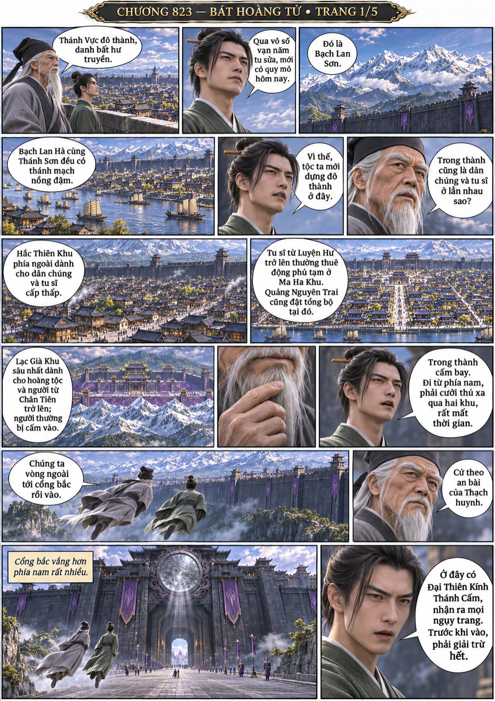
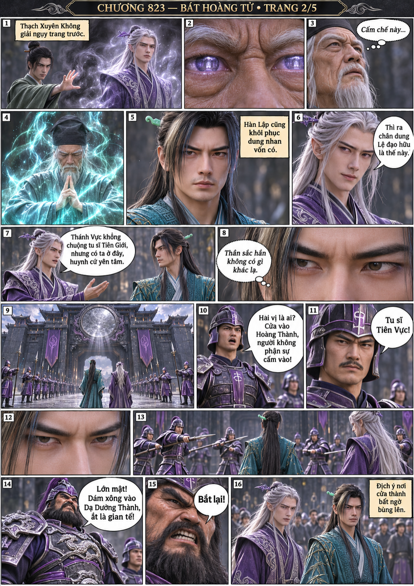
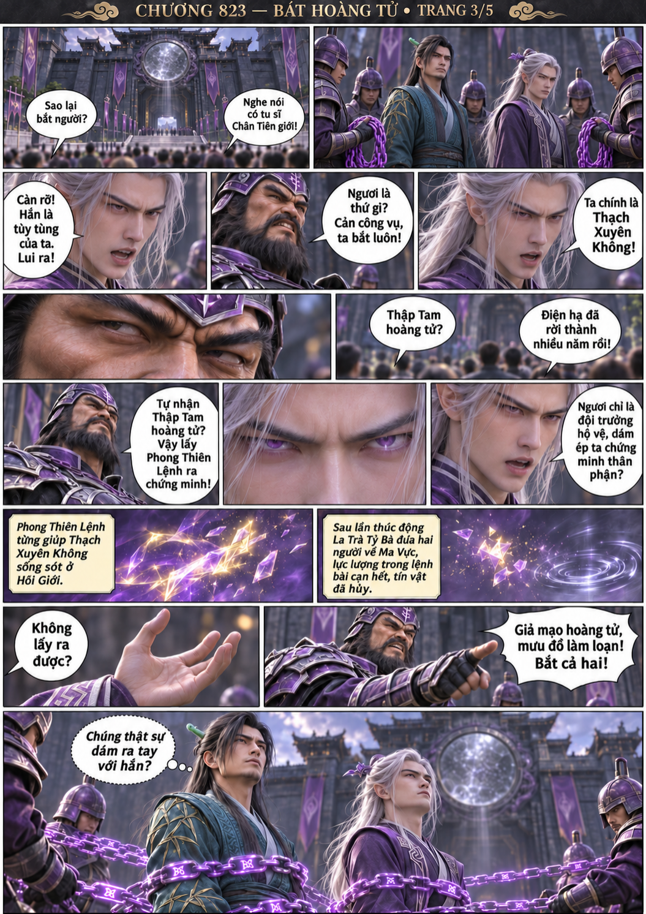
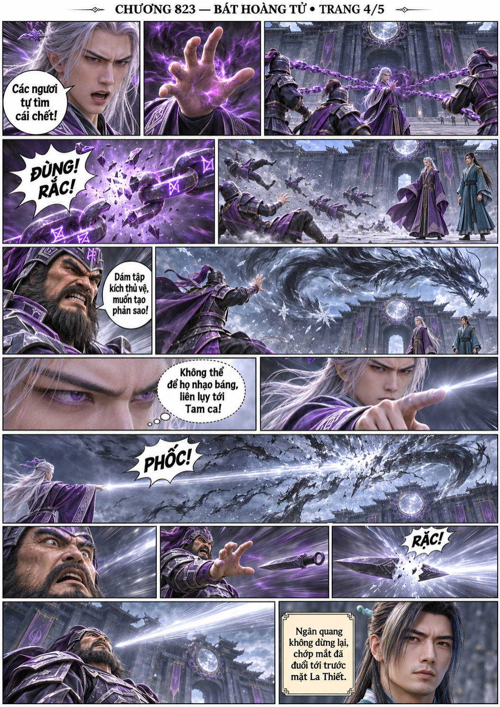
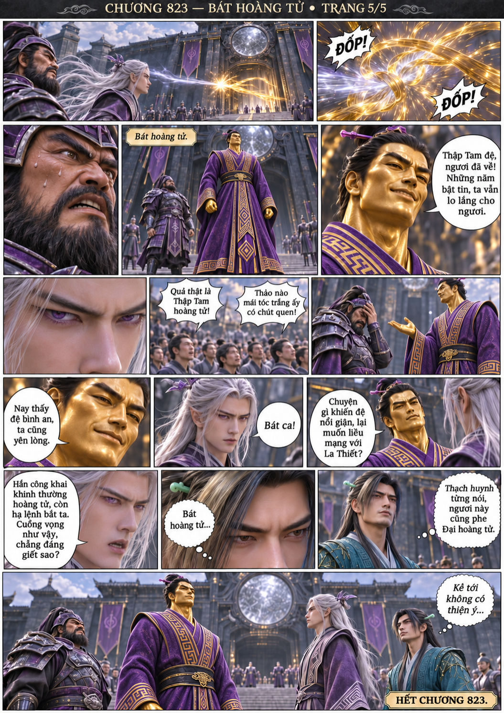

# Chương 823: Bát hoàng tử

5 trang PNG riêng, tỉ lệ A4 dọc; chuyển thể từ văn bản người dùng đính kèm, có thoại, suy nghĩ và lời dẫn. Dùng model tham chiếu trong bộ nhớ dự án.

[PDF A4](chuong-823.pdf) · [Văn bản nguồn](SOURCE.txt)

Hai người giải ngụy trang ở cửa bắc Dạ Dương Thành. La Thiết lấy việc thiếu tín vật làm khó Thạch Xuyên Không; Bát hoàng tử ngăn đòn cuối và xuất hiện.

