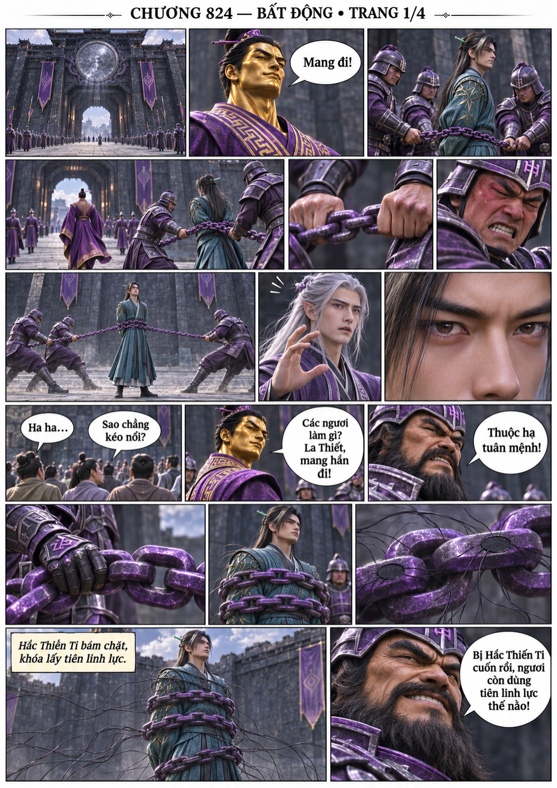
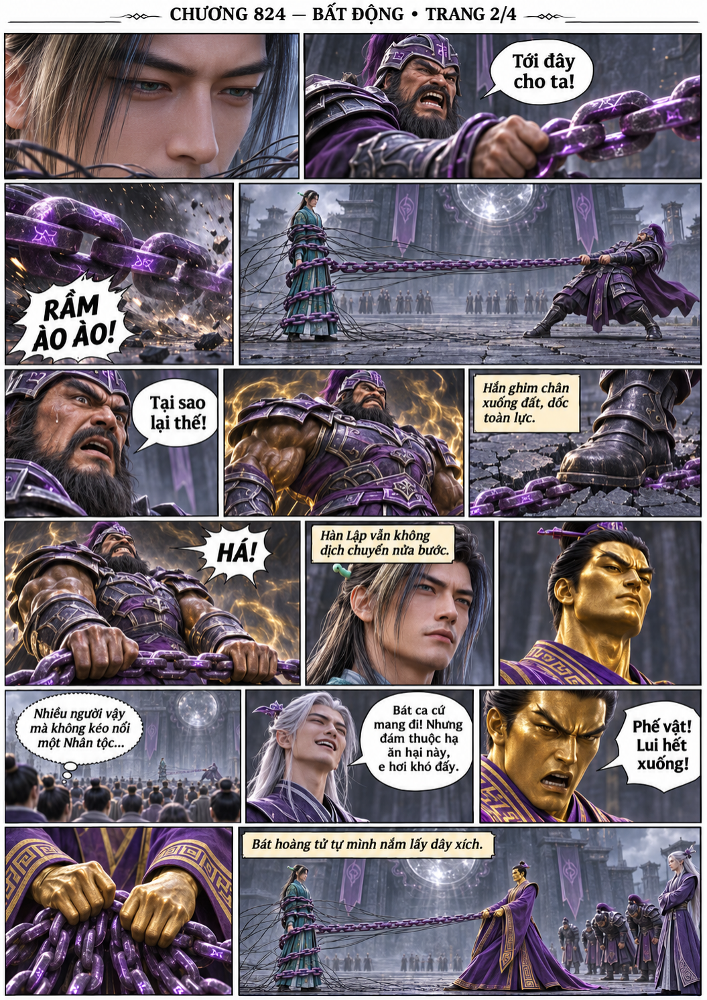
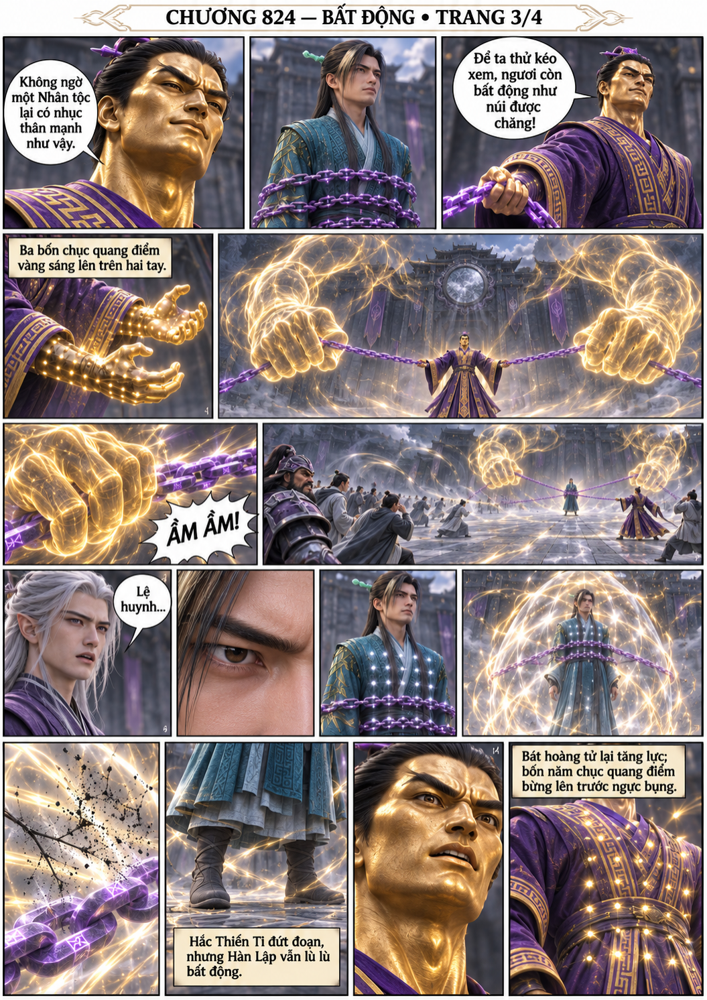
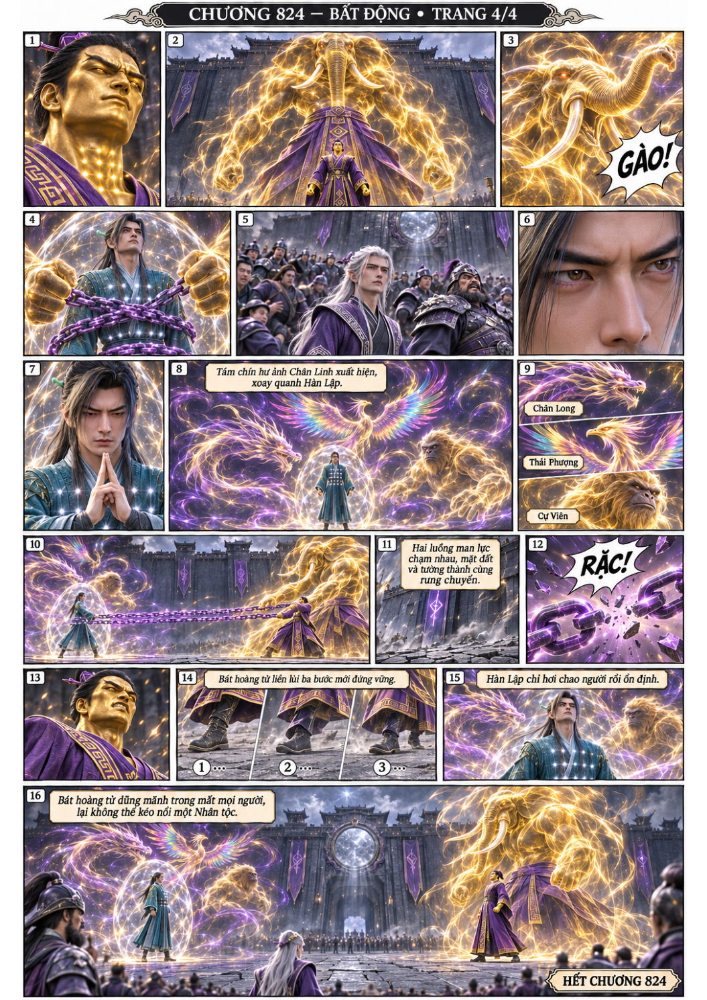

# Chương 824: Bất động

4 trang PNG riêng, tỉ lệ A4 dọc; chuyển thể từ văn bản người dùng đính kèm, có thoại, suy nghĩ và lời dẫn. Dùng model tham chiếu trong bộ nhớ dự án.

[PDF A4](chuong-824.pdf) · [Văn bản nguồn](SOURCE.txt)

Hàn Lập đứng vững trước hai lần gia tăng sức kéo; Bát hoàng tử triệu pháp tướng đầu voi, xiềng xích cuối cùng đứt tung.

