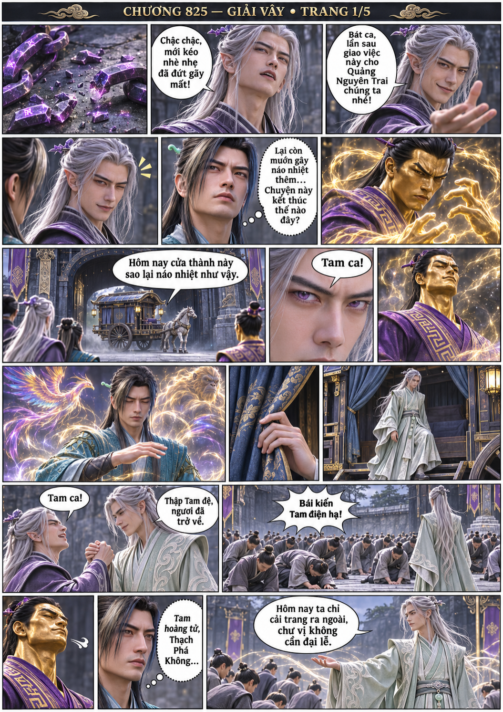
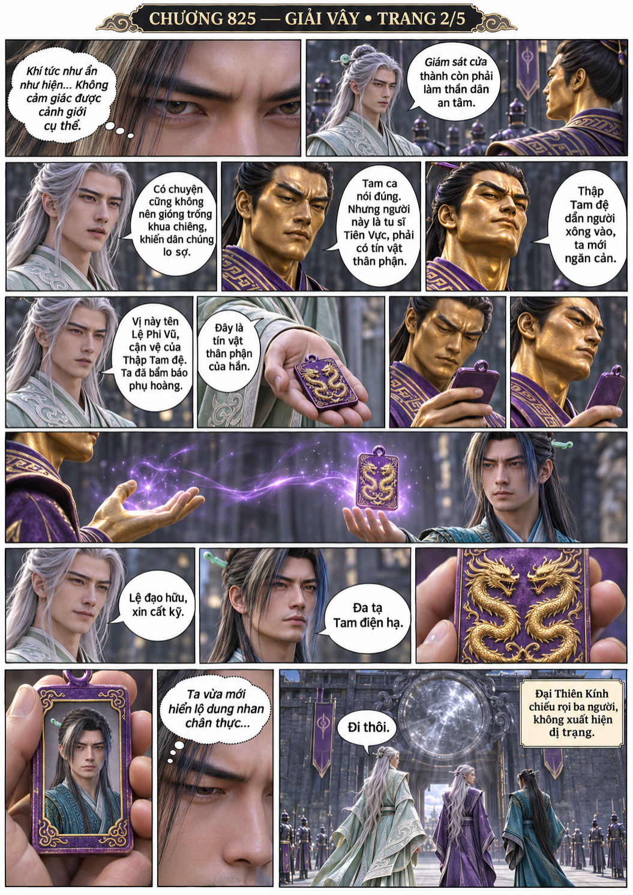
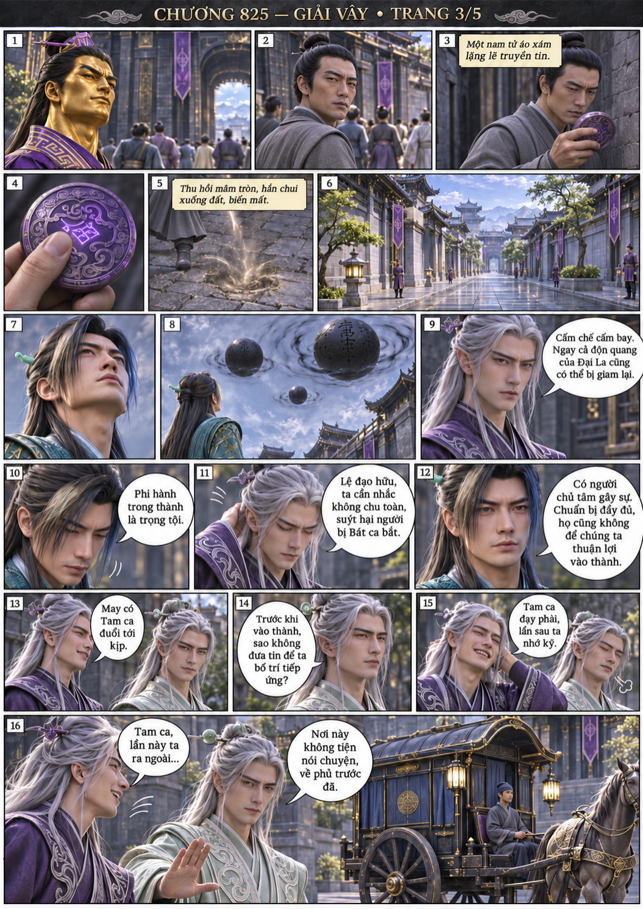
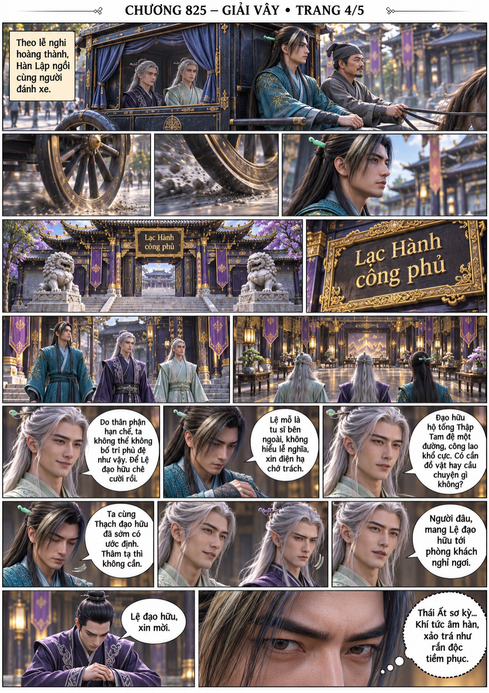
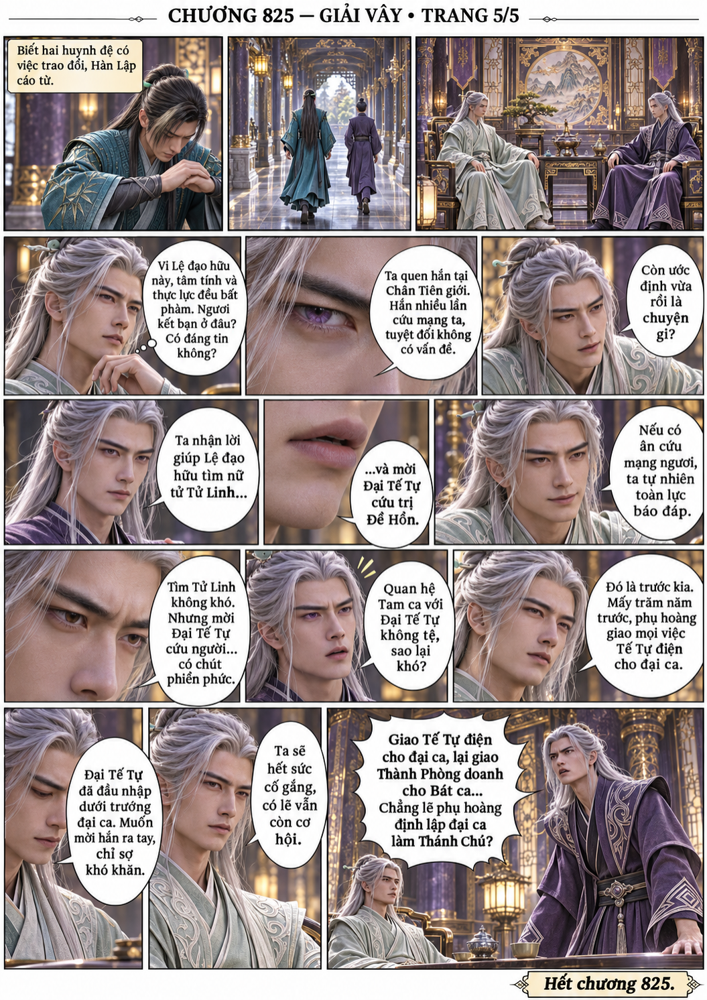

# Chương 825: Giải vây

5 trang PNG riêng, tỉ lệ A4 dọc; chuyển thể từ văn bản người dùng đính kèm, có thoại, suy nghĩ và lời dẫn. Dùng model tham chiếu trong bộ nhớ dự án.

[PDF A4](chuong-825.pdf) · [Văn bản nguồn](SOURCE.txt)

Thạch Phá Không hóa giải xung đột cửa thành, cấp tín vật cho Hàn Lập và đưa hai người về phủ; việc cứu Đề Hồn gặp trở ngại chính trị.

