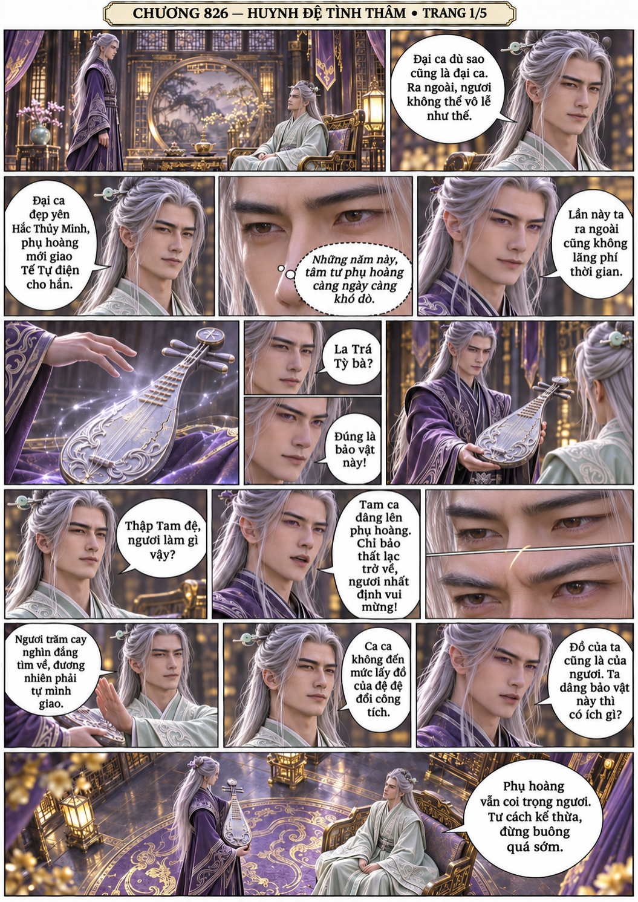
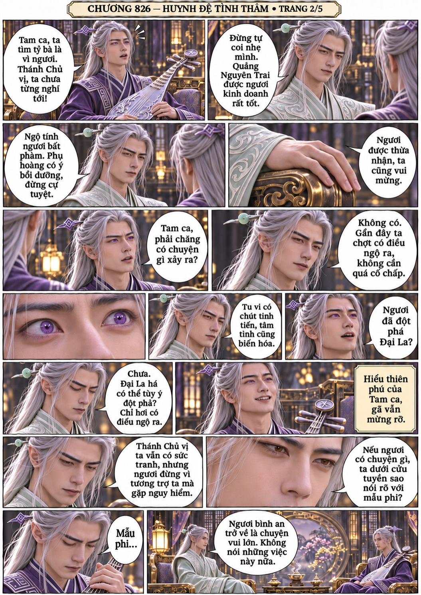
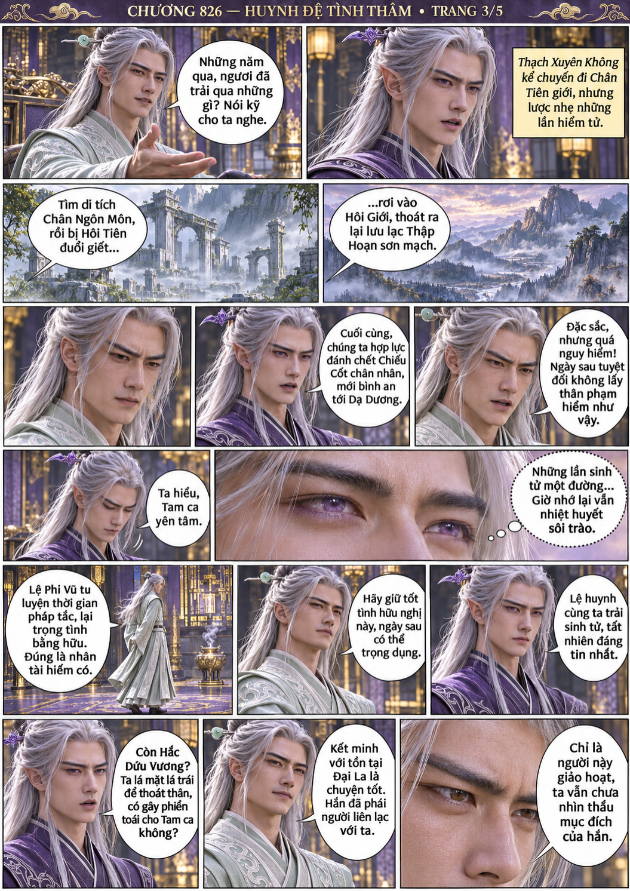
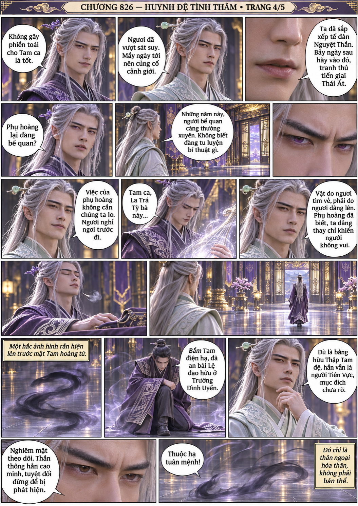
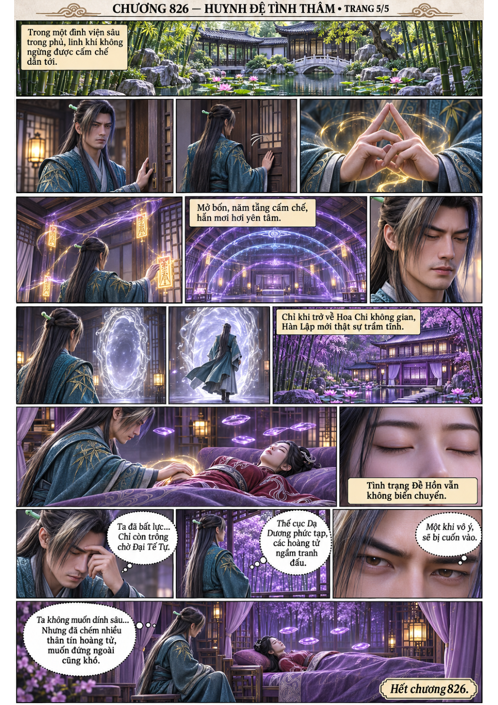

# Chương 826: Huynh đệ tình thâm

5 trang PNG riêng, tỉ lệ A4 dọc; chuyển thể từ văn bản người dùng đính kèm, có thoại, suy nghĩ và lời dẫn. Dùng model tham chiếu trong bộ nhớ dự án.

[PDF A4](chuong-826.pdf) · [Văn bản nguồn](SOURCE.txt)

Hai huynh đệ nói về quyền kế thừa và chuyến đi; Tam hoàng tử âm thầm bố trí giám sát, trong khi Hàn Lập kiểm tra Đề Hồn còn hôn mê.

