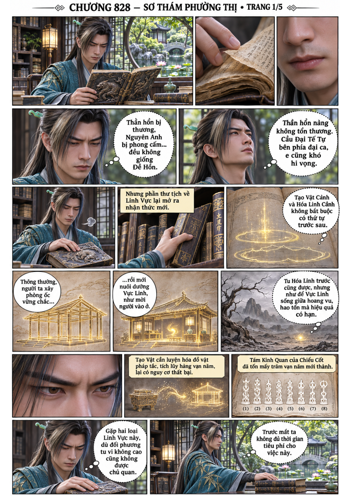
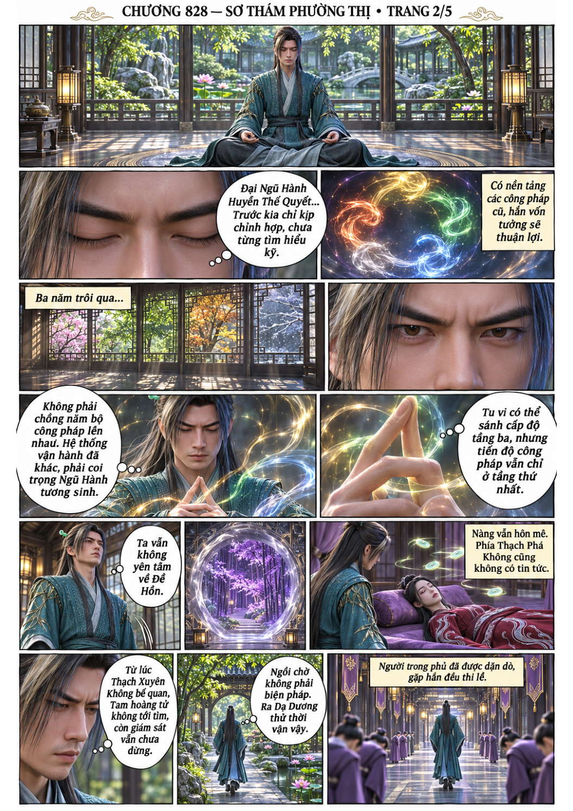
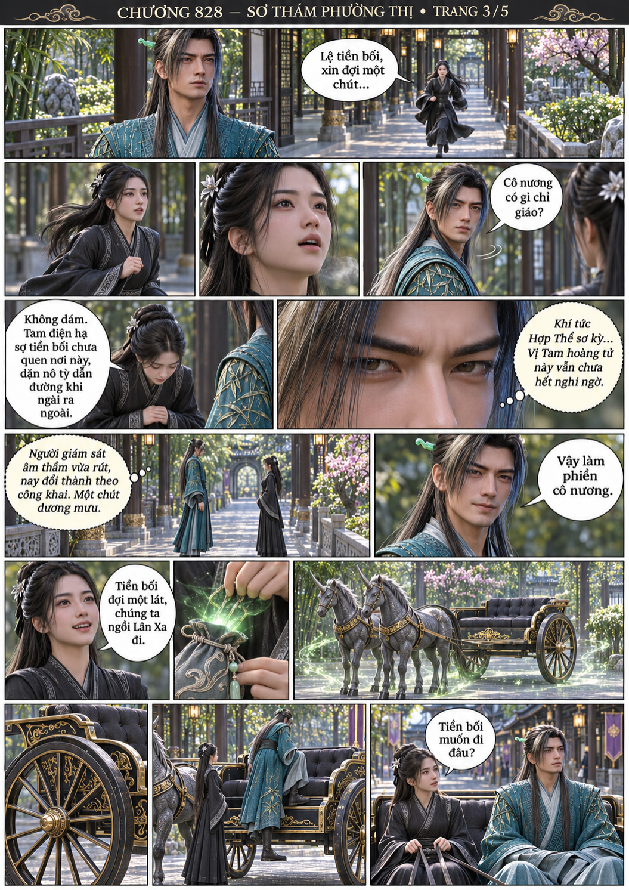
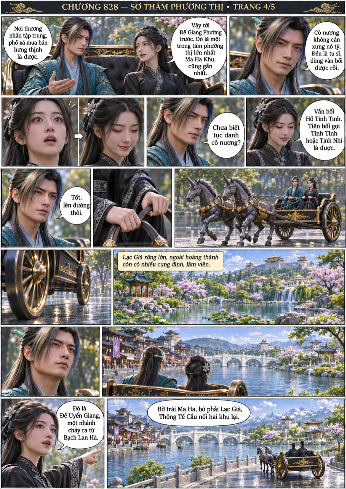
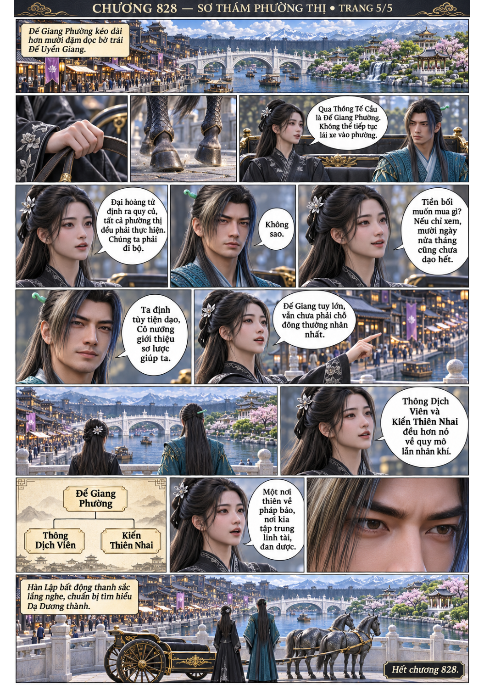

# Chương 828: Sơ thám phường thị

5 trang PNG riêng, tỉ lệ A4 dọc; chuyển thể từ văn bản người dùng đính kèm, có thoại, suy nghĩ và lời dẫn. Dùng model tham chiếu trong bộ nhớ dự án.

[PDF A4](chuong-828.pdf) · [Văn bản nguồn](SOURCE.txt)

Hàn Lập đọc về Linh Vực, bế quan ba năm rồi quyết định ra ngoài; Hồ Tinh Tinh dẫn hắn tới Đế Giang Phường.

