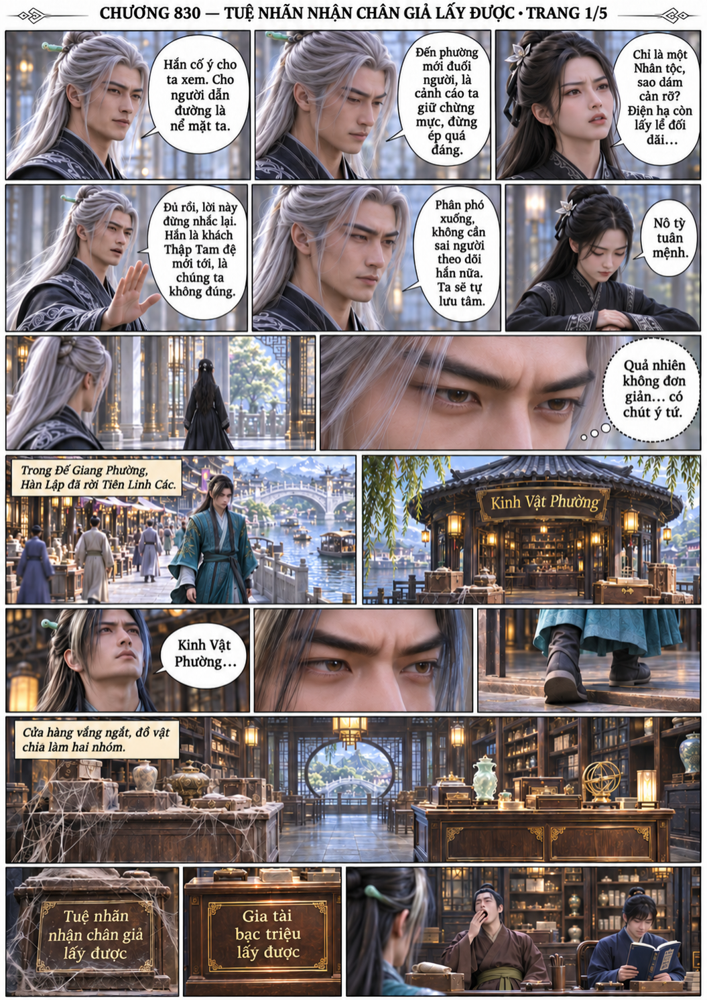
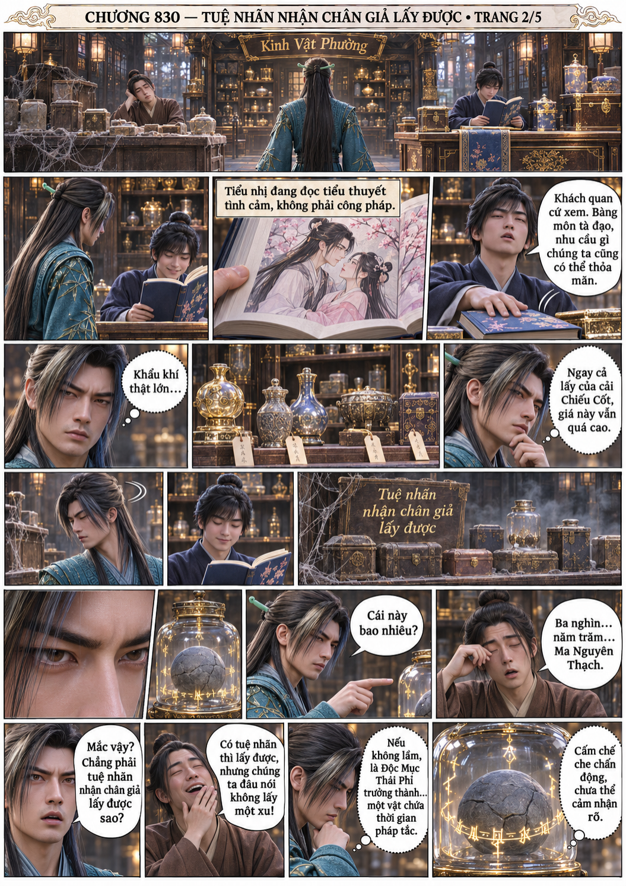
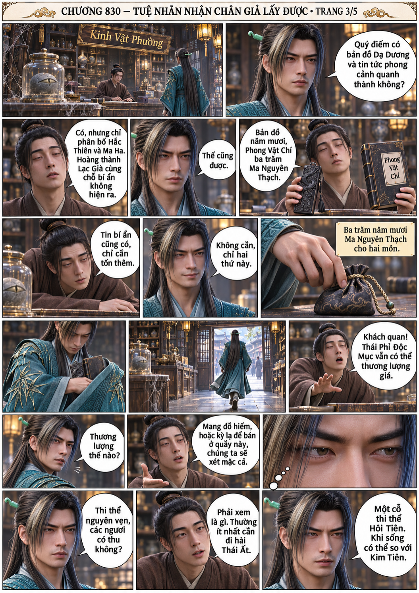
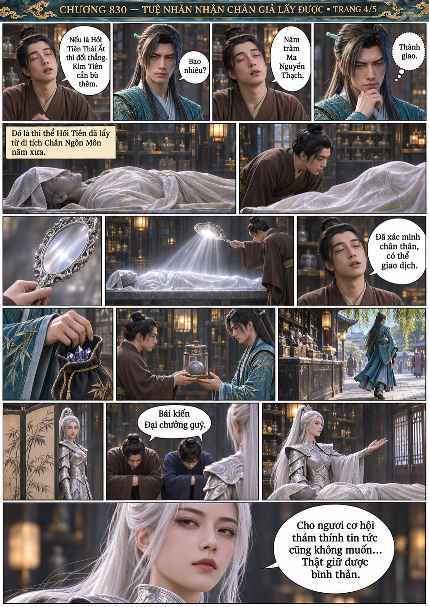
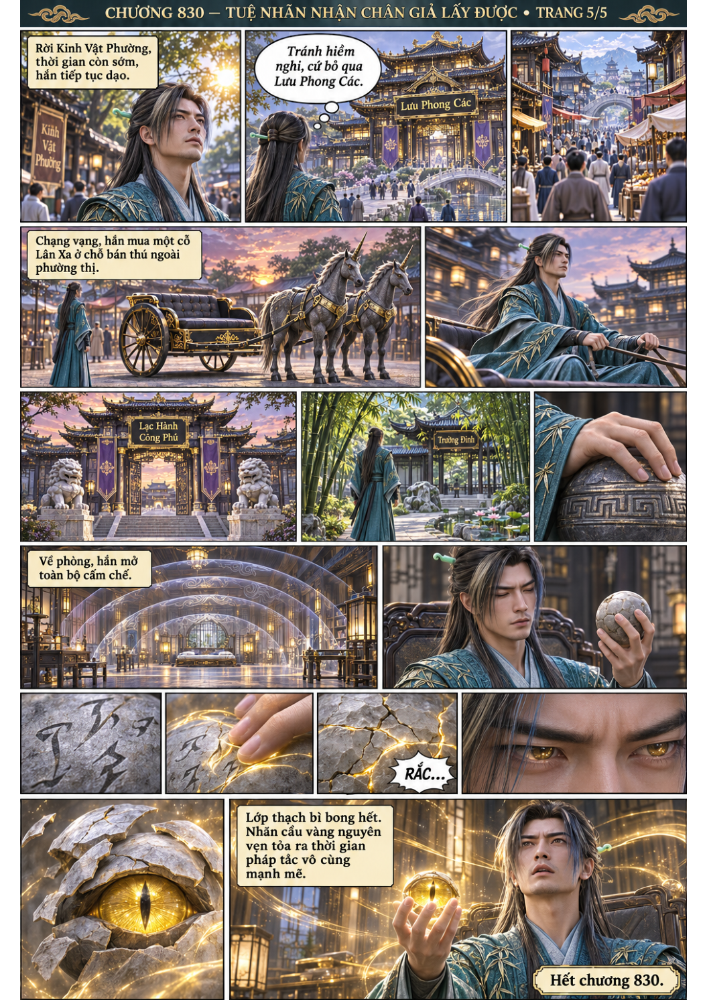

# Chương 830: Tuệ nhãn nhận chân giả lấy được

5 trang PNG riêng, tỉ lệ A4 dọc; chuyển thể từ văn bản người dùng đính kèm, có thoại, suy nghĩ và lời dẫn. Dùng model tham chiếu trong bộ nhớ dự án.

[PDF A4](chuong-830.pdf) · [Văn bản nguồn](SOURCE.txt)

Tam hoàng tử dừng giám sát; Hàn Lập mua bản đồ, đổi lấy Thái Phỉ Độc Mục rồi phát hiện nhãn cầu vàng ẩn sau lớp đá.

