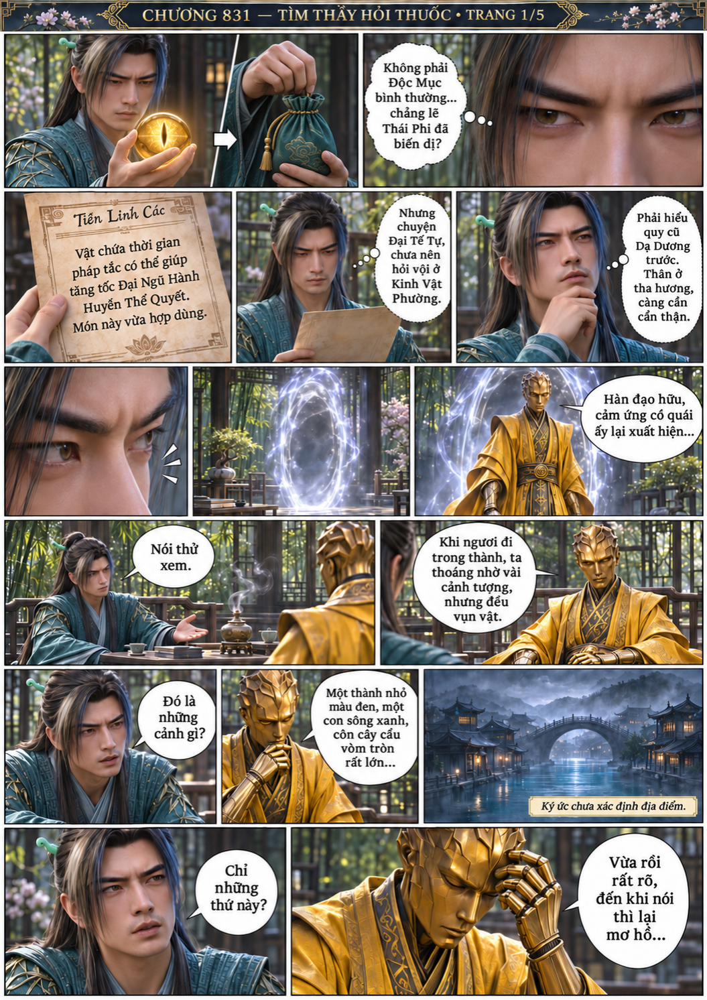
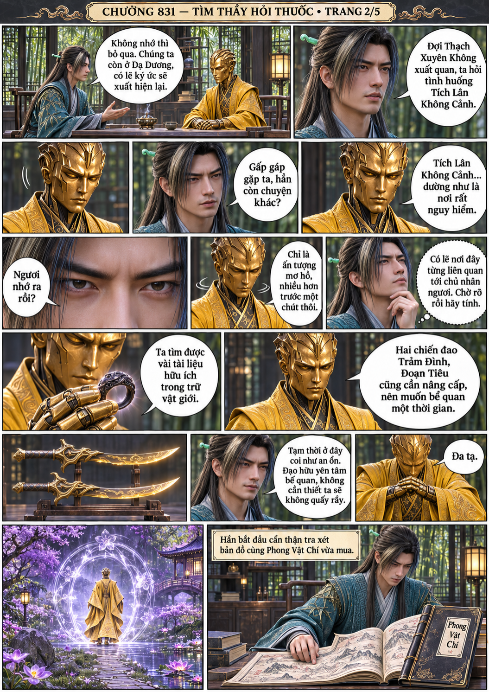
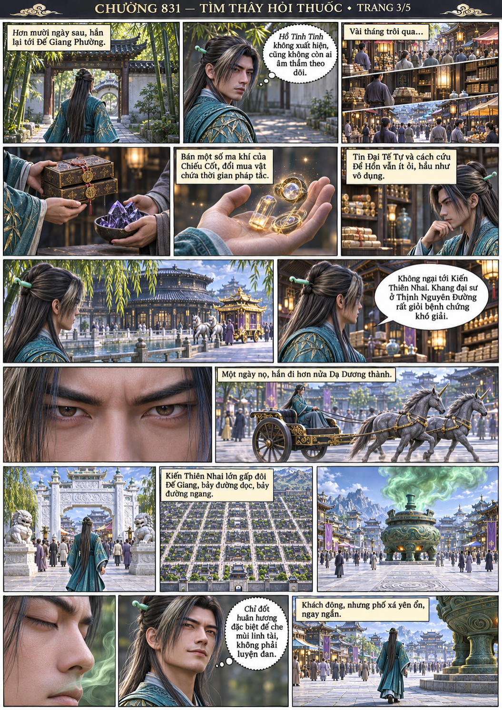
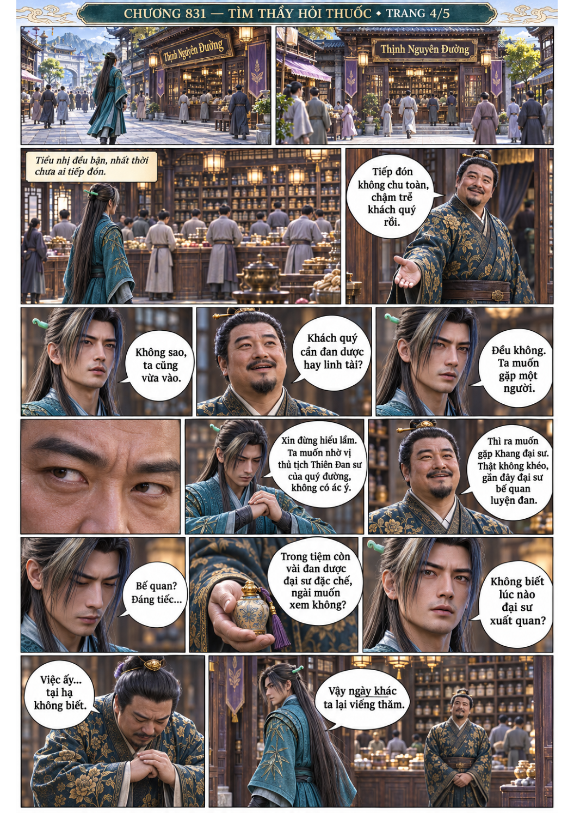
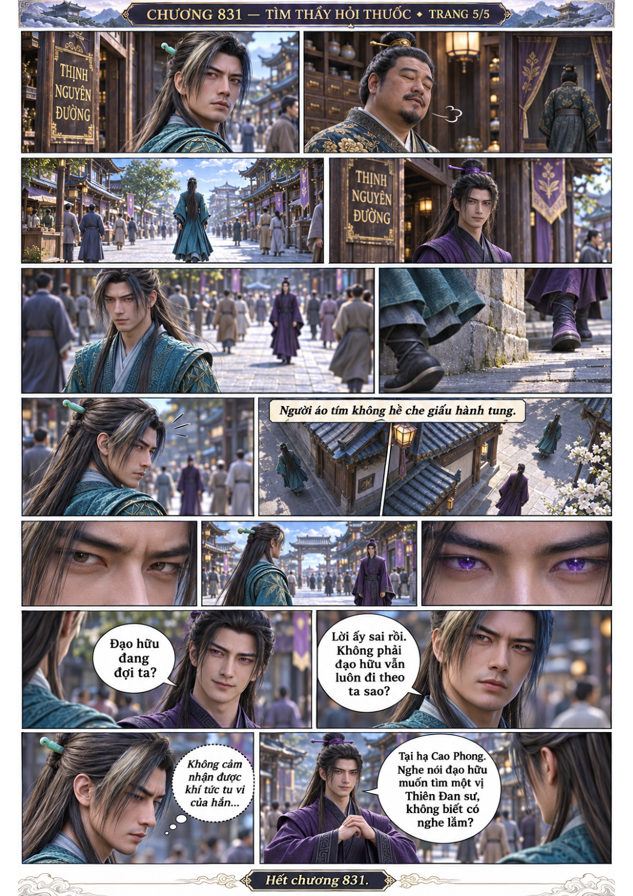

# Chương 831: Tìm thầy hỏi thuốc

5 trang PNG riêng, tỉ lệ A4 dọc; chuyển thể từ văn bản người dùng đính kèm, có thoại, suy nghĩ và lời dẫn. Dùng model tham chiếu trong bộ nhớ dự án.

[PDF A4](chuong-831.pdf) · [Văn bản nguồn](SOURCE.txt)

Giải Đạo Nhân kể ký ức vụn rồi bế quan; Hàn Lập tìm thầy thuốc chưa gặp Khang đại sư, sau đó được Cao Phong tiếp cận.

