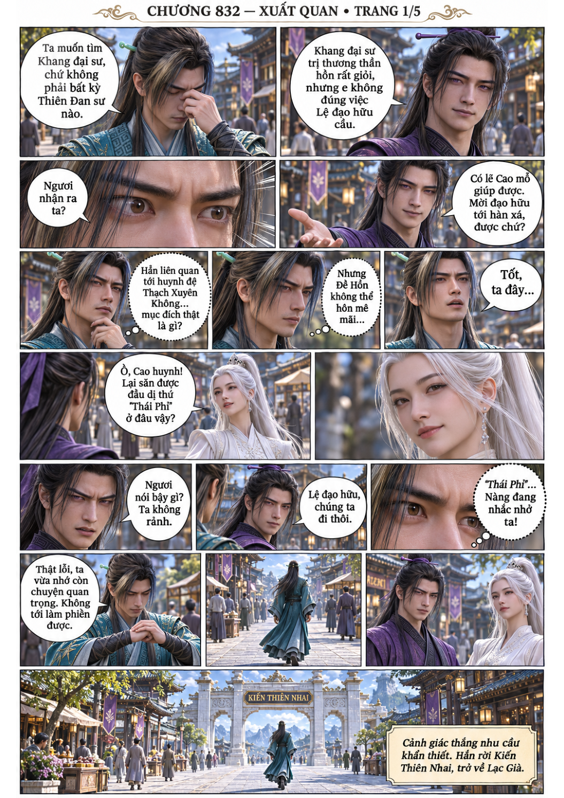
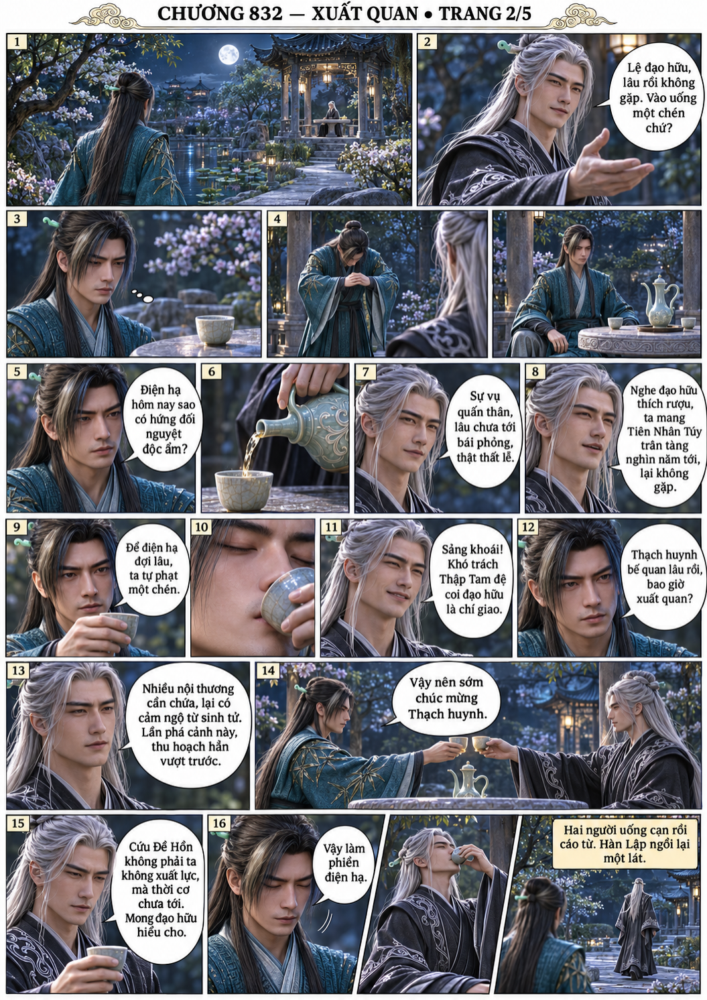
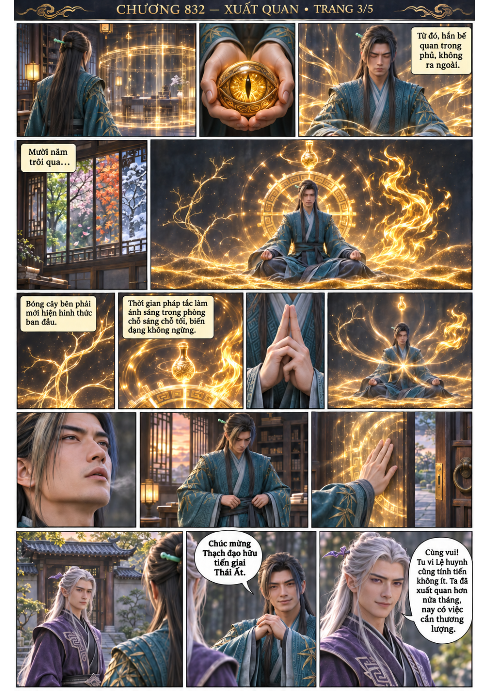
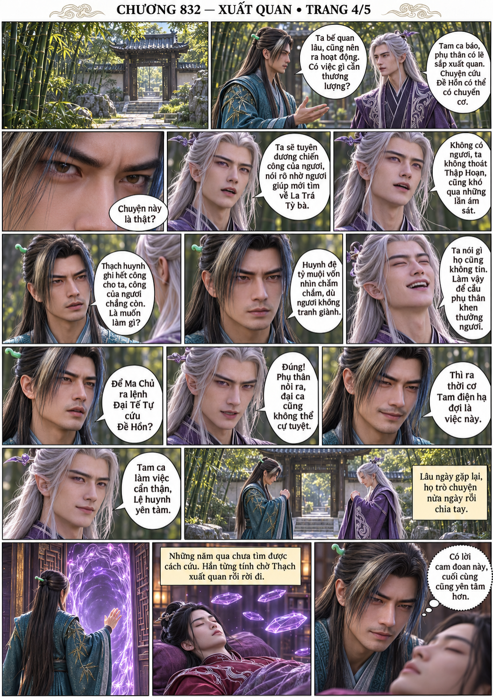
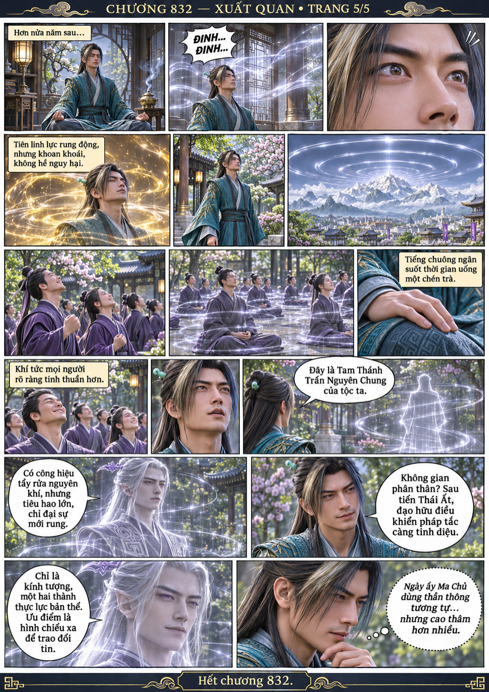

# Chương 832: Xuất quan

5 trang PNG riêng, tỉ lệ A4 dọc; chuyển thể từ văn bản người dùng đính kèm, có thoại, suy nghĩ và lời dẫn. Dùng model tham chiếu trong bộ nhớ dự án.

[PDF A4](chuong-832.pdf) · [Văn bản nguồn](SOURCE.txt)

Hàn Lập từ chối Cao Phong sau lời nhắc, bế quan mười năm rồi gặp Thạch đã tiến Thái Ất; tiếng chuông báo đại sự và phân thân truyền tin xuất hiện.

