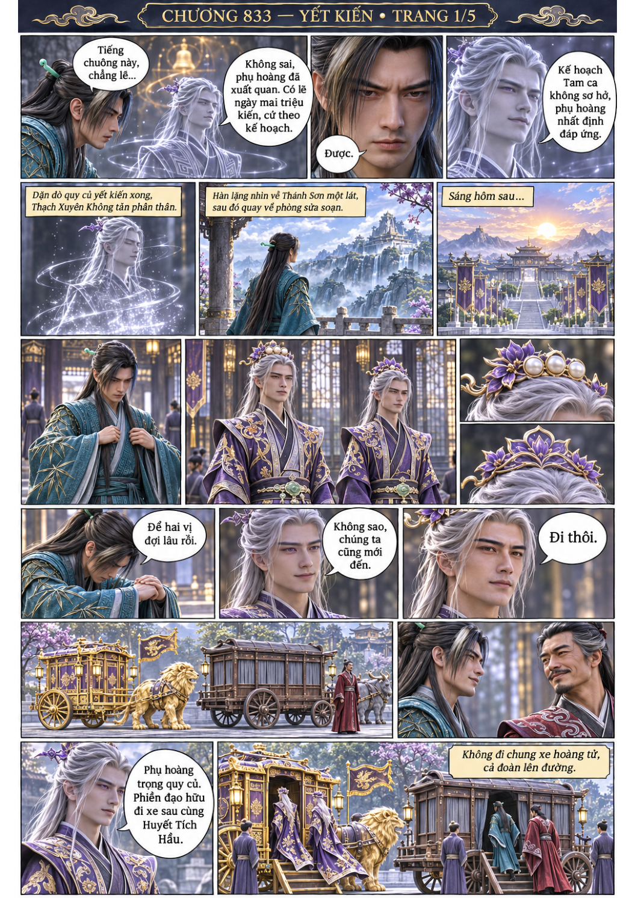
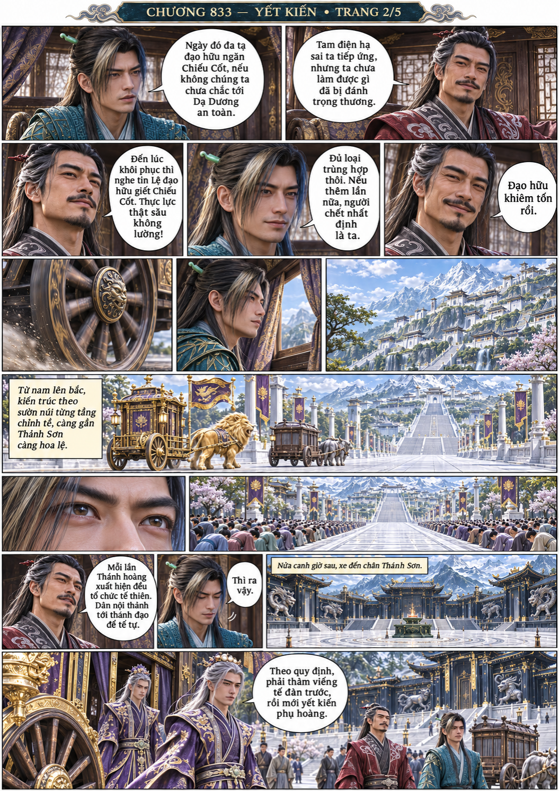
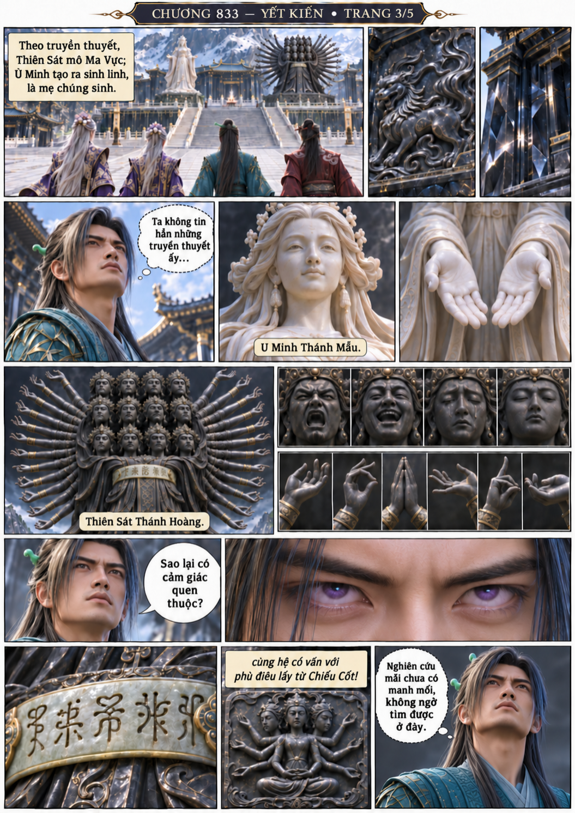
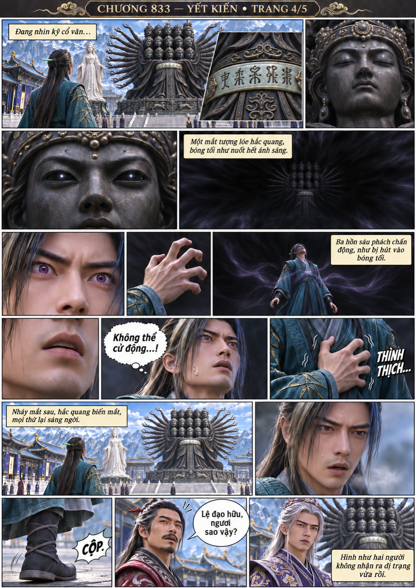
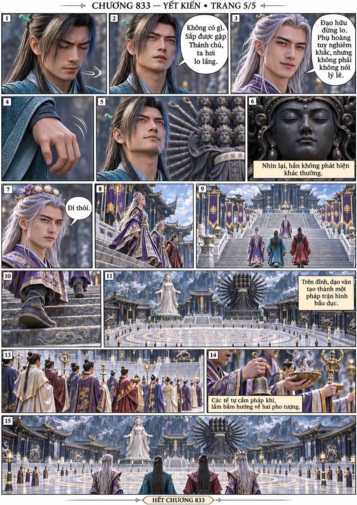

# Chương 833: Yết kiến

5 trang PNG riêng, tỉ lệ A4 dọc; chuyển thể từ văn bản người dùng đính kèm, có thoại, suy nghĩ và lời dẫn. Dùng model tham chiếu trong bộ nhớ dự án.

[PDF A4](chuong-833.pdf) · [Văn bản nguồn](SOURCE.txt)

Đoàn chuẩn bị yết kiến, đi lễ tại Thánh Sơn; Hàn Lập phát hiện cổ văn quen thuộc và chịu một dị tượng thoáng qua trước hai pho tượng.

