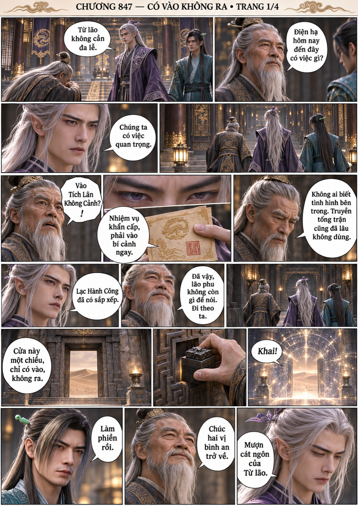
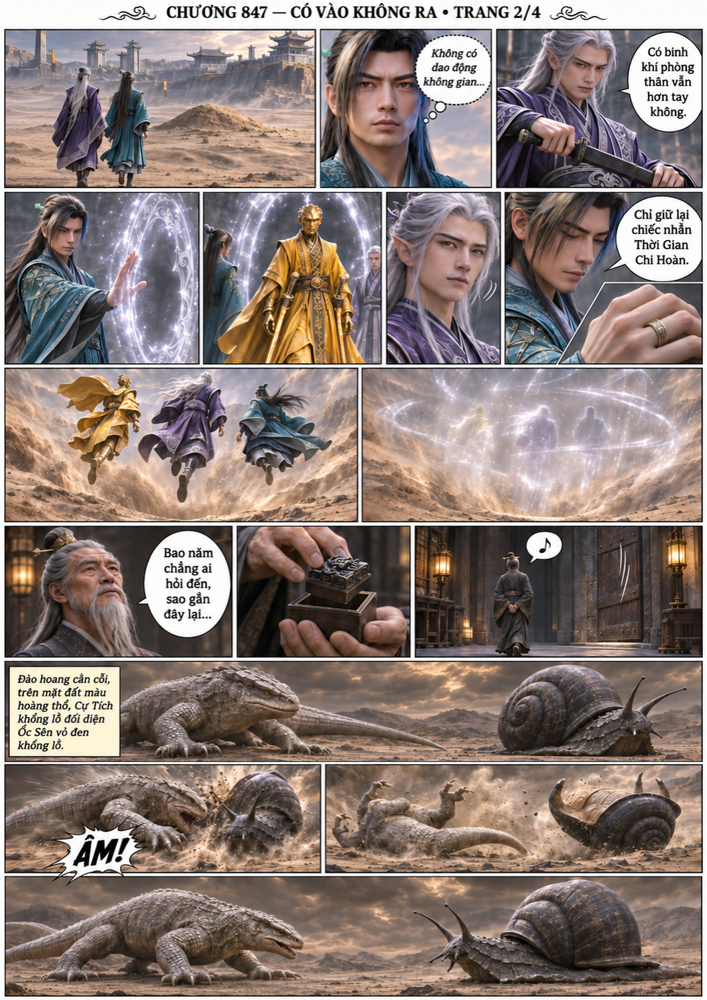
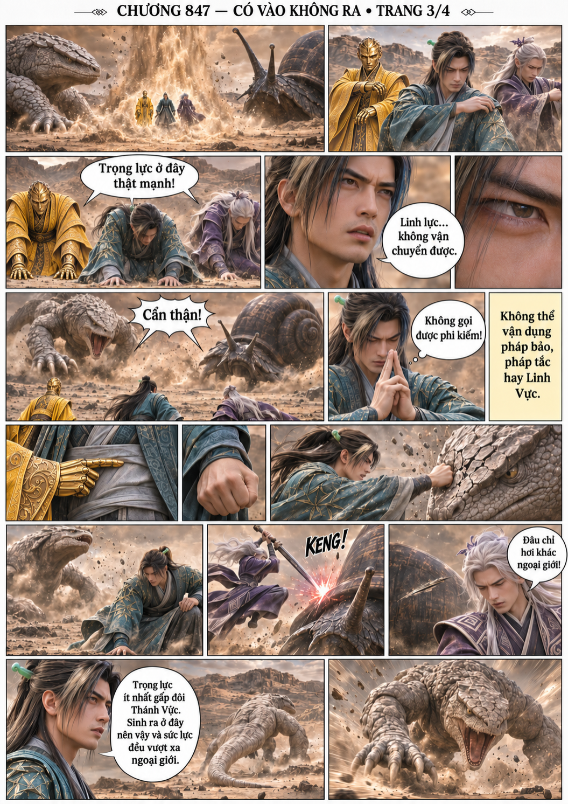
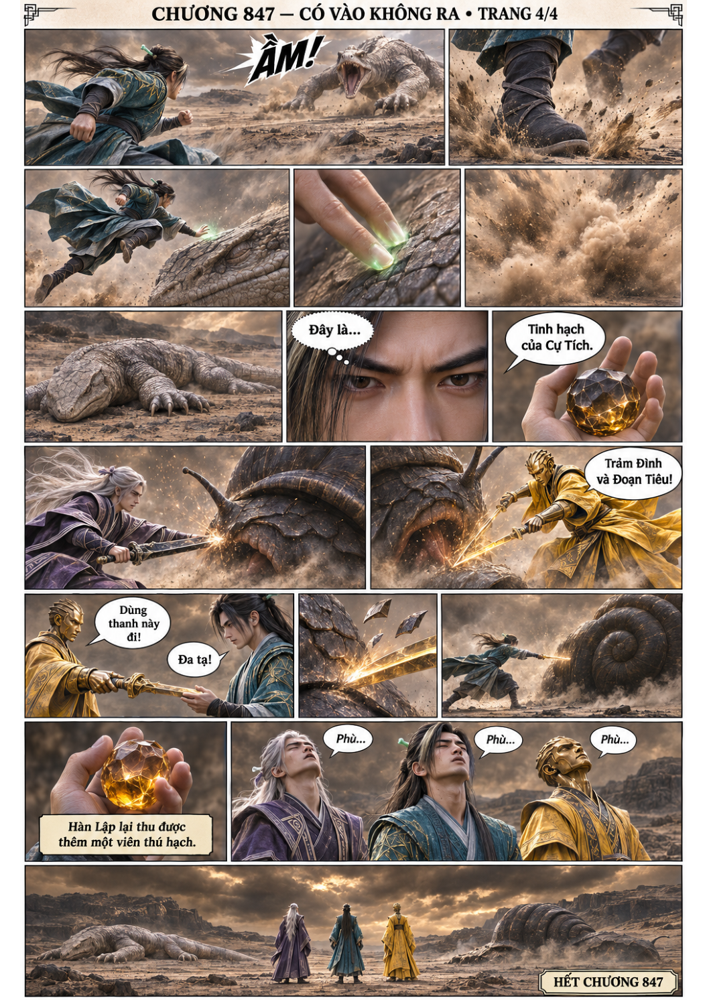

# Chương 847: Có Vào Không Ra

4 trang PNG riêng, tỉ lệ A4 dọc; chuyển thể từ văn bản người dùng đính kèm, có thoại, suy nghĩ và lời dẫn. Dùng model tham chiếu trong bộ nhớ dự án.

[PDF A4](chuong-847.pdf) · [Văn bản nguồn](SOURCE.txt)

Hàn Lập và Thạch Xuyên Không qua cửa một chiều vào Tích Lân Không Cảnh. Ở đảo hoang, cả hai cùng Giải Đạo Nhân chống lại hai dị thú và thu được thú hạch.

