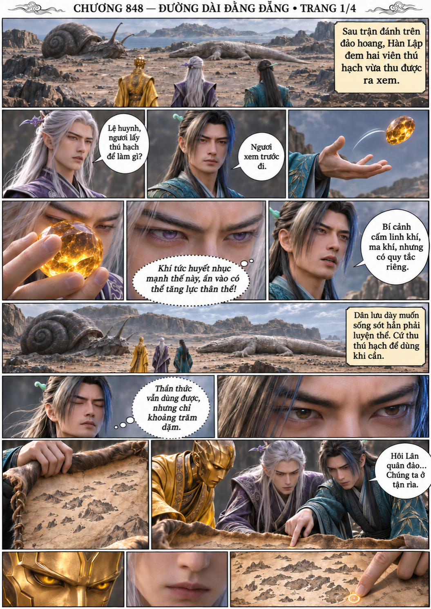
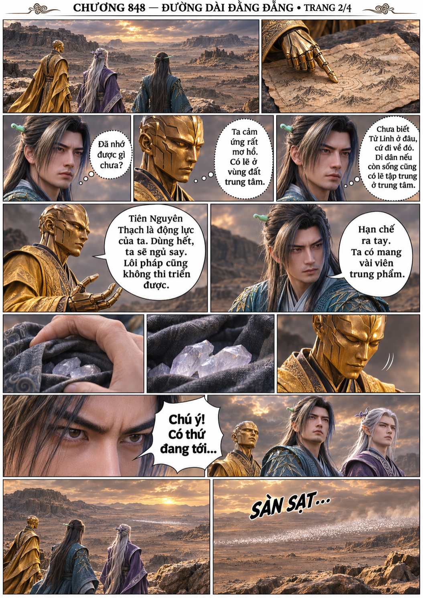
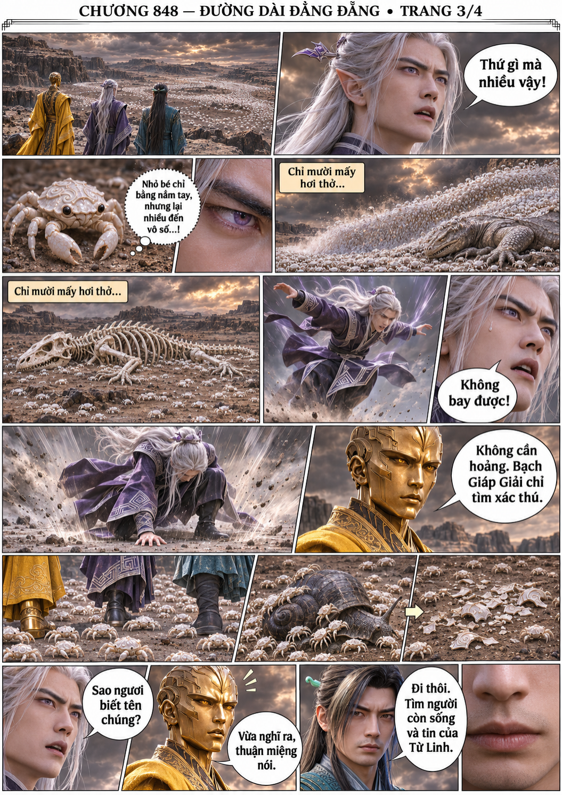
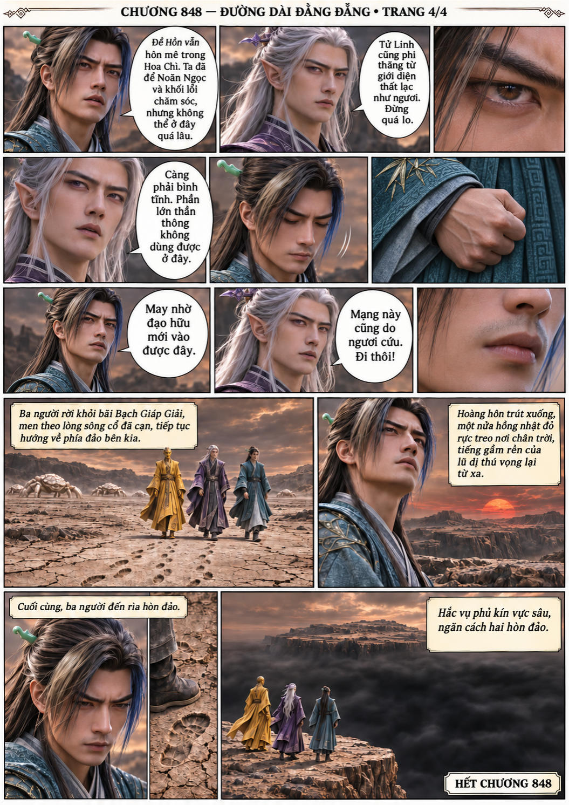

# Chương 848: Đường Dài Đằng Đẵng

4 trang PNG riêng, tỉ lệ A4 dọc; chuyển thể từ văn bản người dùng đính kèm, có thoại, suy nghĩ và lời dẫn. Dùng model tham chiếu trong bộ nhớ dự án.

[PDF A4](chuong-848.pdf) · [Văn bản nguồn](SOURCE.txt)

Ba người phát hiện công dụng của thú hạch, định hướng bằng bản đồ da thú và đến vực hắc vụ sau khi gặp đàn Bạch Giáp Giải.

