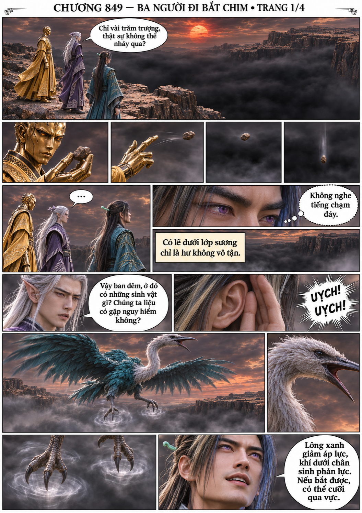
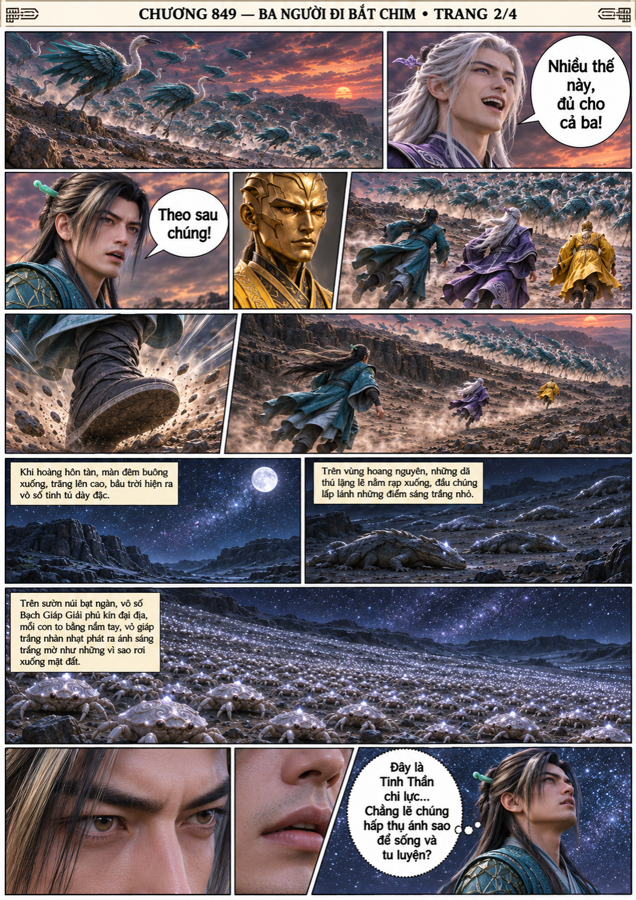
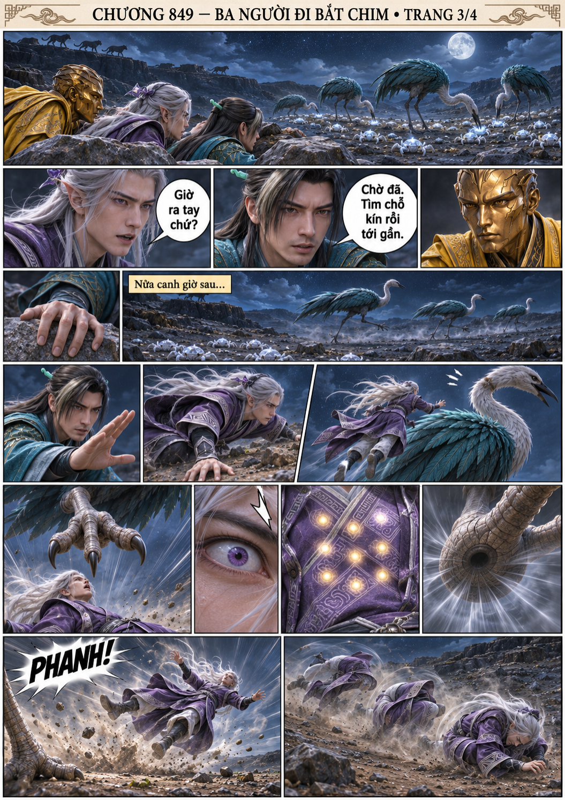
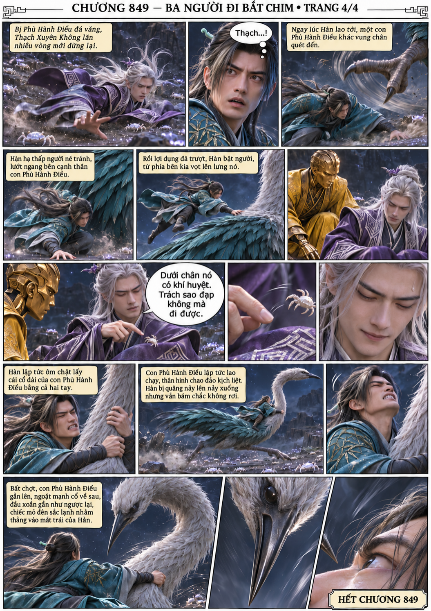

# Chương 849: Ba Người Đi Bắt Chim

4 trang PNG riêng, tỉ lệ A4 dọc; chuyển thể từ văn bản người dùng đính kèm, có thoại, suy nghĩ và lời dẫn. Dùng model tham chiếu trong bộ nhớ dự án.

[PDF A4](chuong-849.pdf) · [Văn bản nguồn](SOURCE.txt)

Ba người phát hiện bầy chim có thể vượt vực hắc vụ, đuổi theo đến sườn núi và tìm cách bắt một con.

