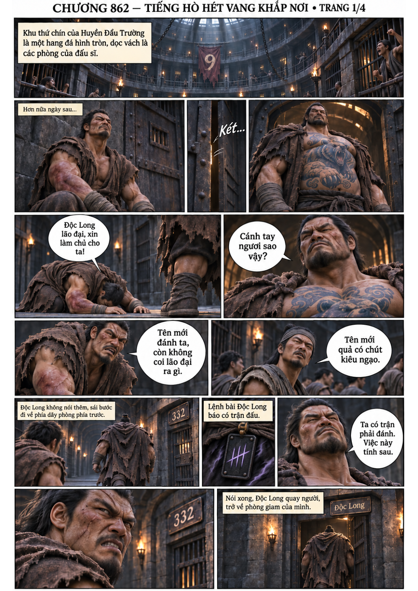
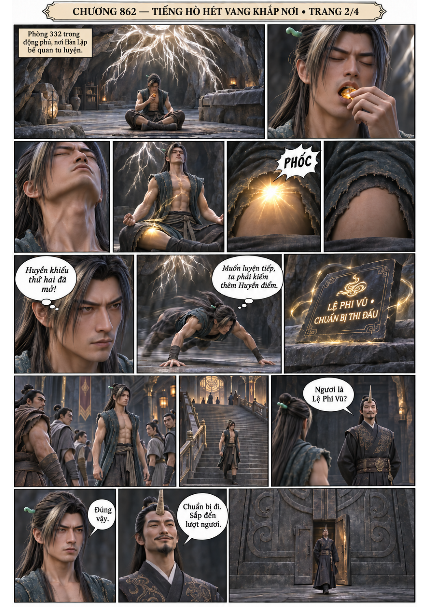
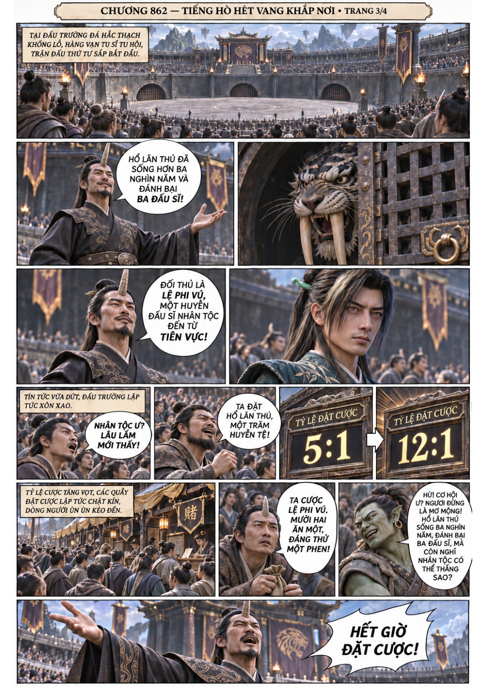
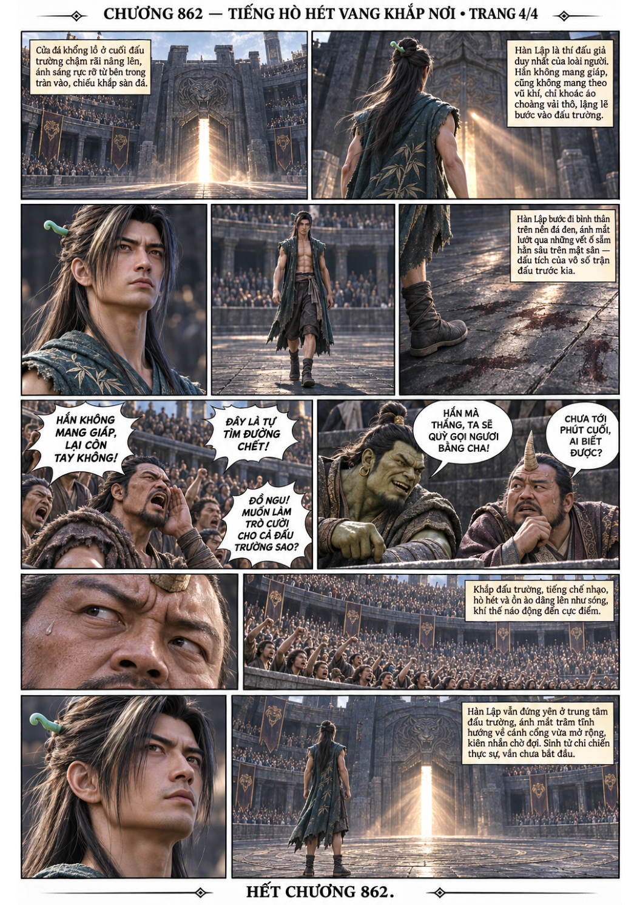

# Chương 862: Chương 862: Tiếng Hò Hét Vang Khắp Nơi

4 trang PNG riêng, tỉ lệ A4 dọc; chuyển thể từ văn bản người dùng đính kèm, có thoại, suy nghĩ và lời dẫn. Dùng model tham chiếu trong bộ nhớ dự án.

[PDF A4](chuong-862.pdf) · [Văn bản nguồn](SOURCE.txt)

Độc Long hoãn việc tìm Hàn Lập. Hàn Lập mở huyền khiếu thứ hai của công pháp và bước ra đấu trường đón trận đầu.

