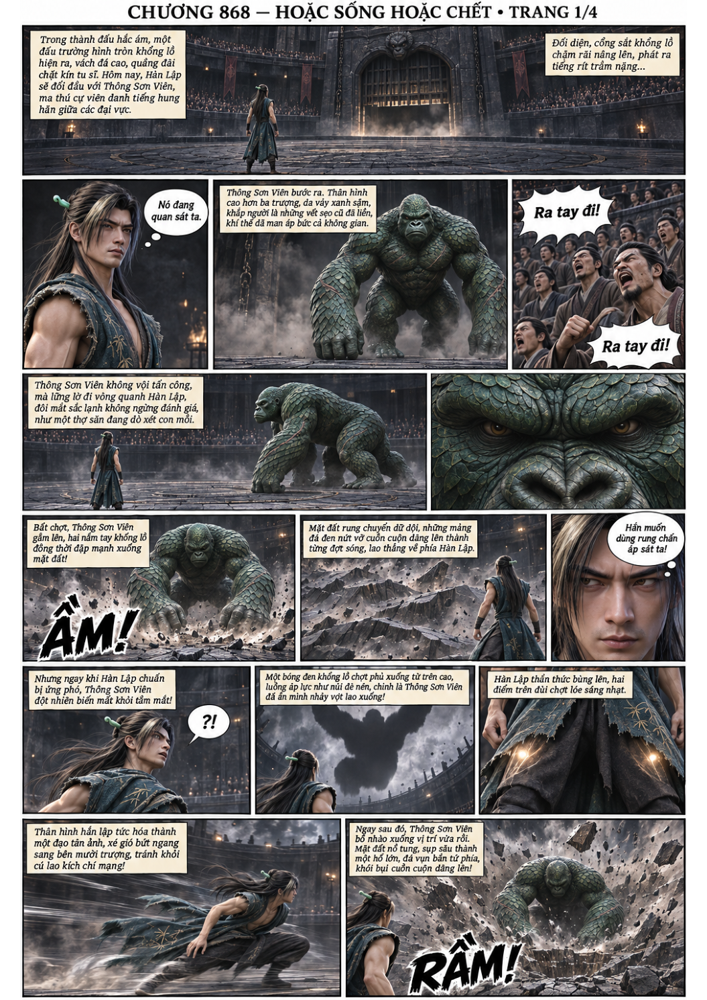
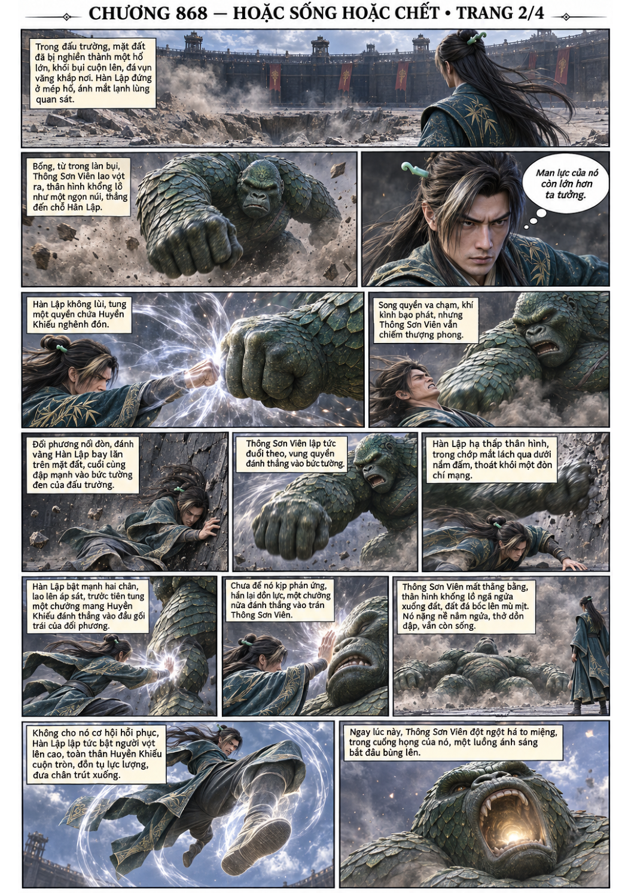
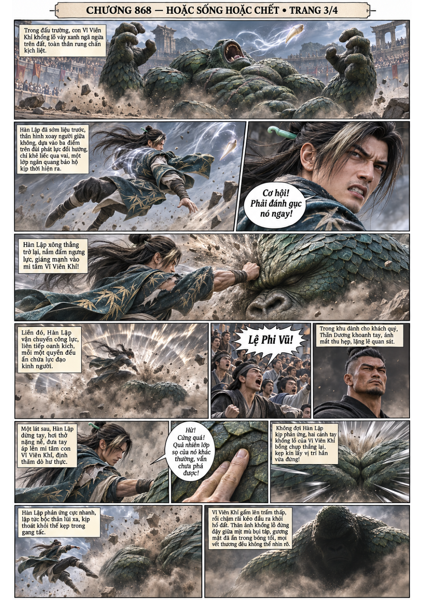
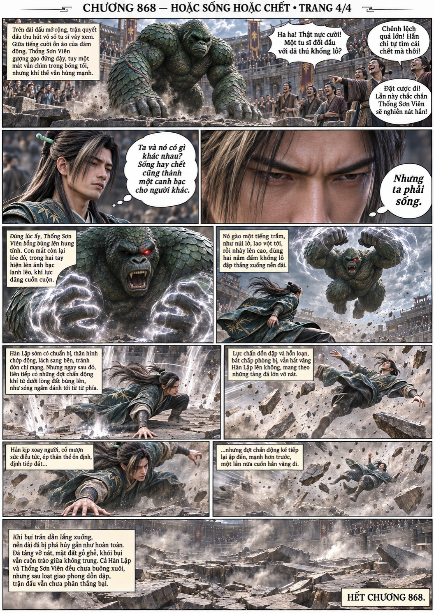

# Chương 868: Hoặc Sống Hoặc Chết

4 trang PNG riêng, tỉ lệ A4 dọc; chuyển thể từ văn bản người dùng đính kèm, có thoại, suy nghĩ và lời dẫn. Dùng model tham chiếu trong bộ nhớ dự án.

[PDF A4](chuong-868.pdf) · [Văn bản nguồn](SOURCE.txt)

Thông Sơn Viên áp đảo Hàn Lập bằng sức mạnh và tốc độ. Hắn tìm cách xoay chuyển thế trận.

