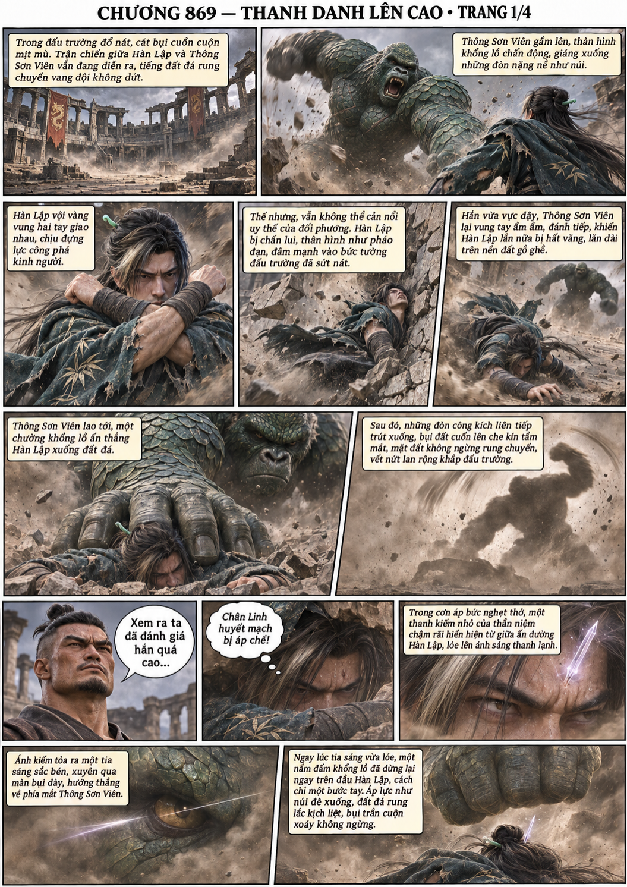
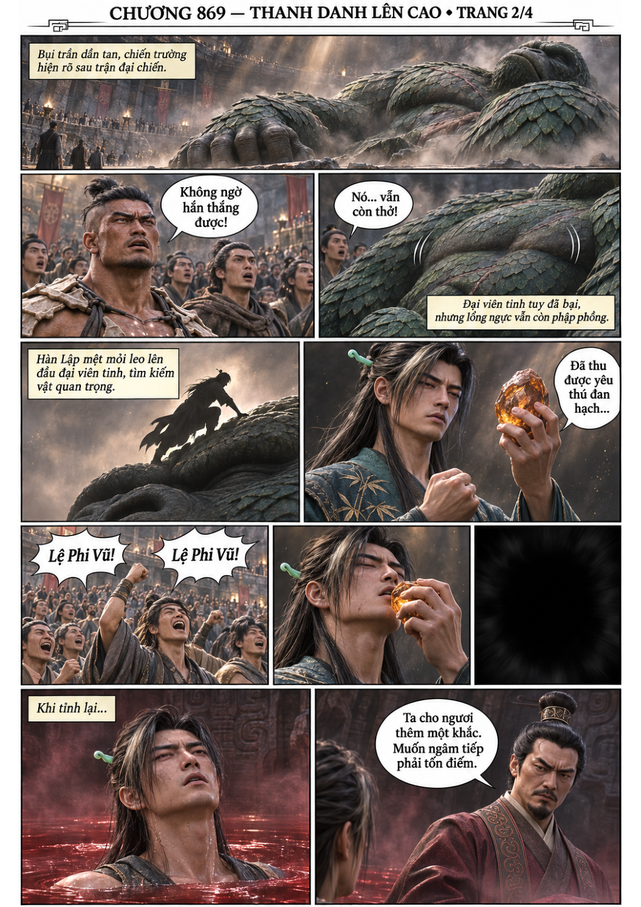
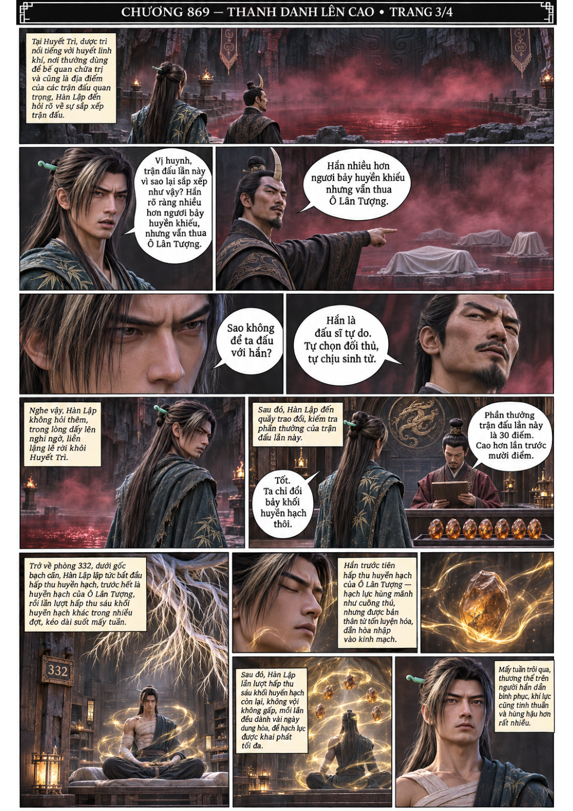
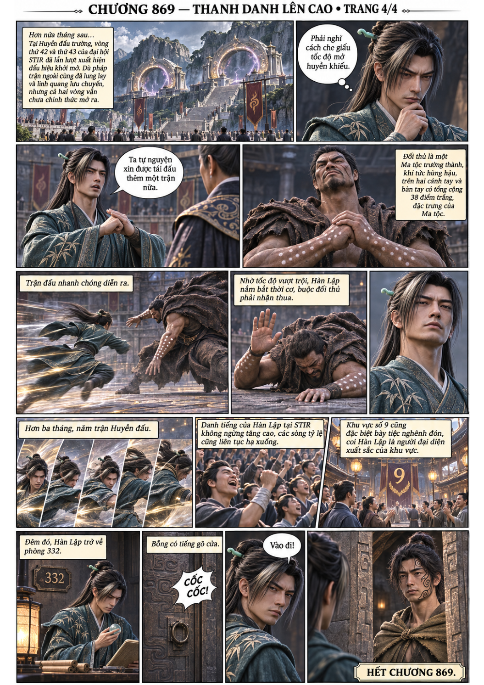

# Chương 869: Thanh Danh Lên Cao

4 trang PNG riêng, tỉ lệ A4 dọc; chuyển thể từ văn bản người dùng đính kèm, có thoại, suy nghĩ và lời dẫn. Dùng model tham chiếu trong bộ nhớ dự án.

[PDF A4](chuong-869.pdf) · [Văn bản nguồn](SOURCE.txt)

Hàn Lập đánh bại Thông Sơn Viên, chữa thương và tiếp tục luyện công.

