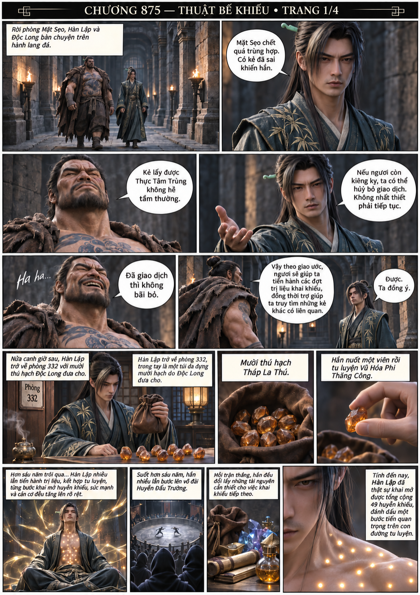
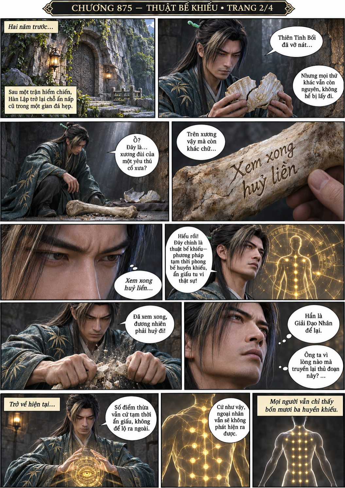
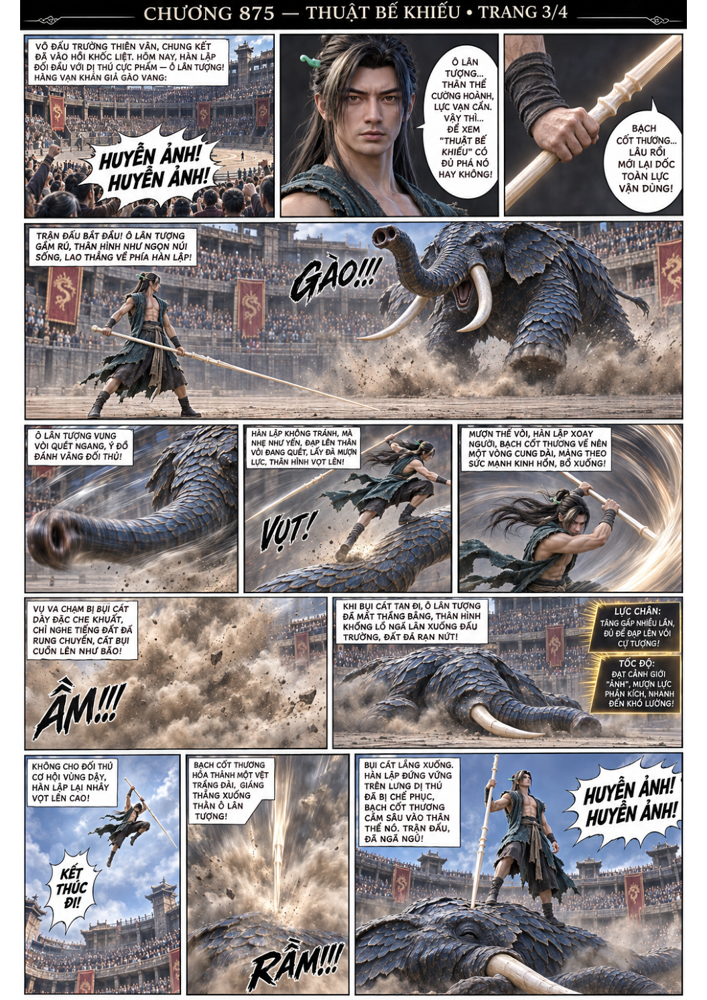
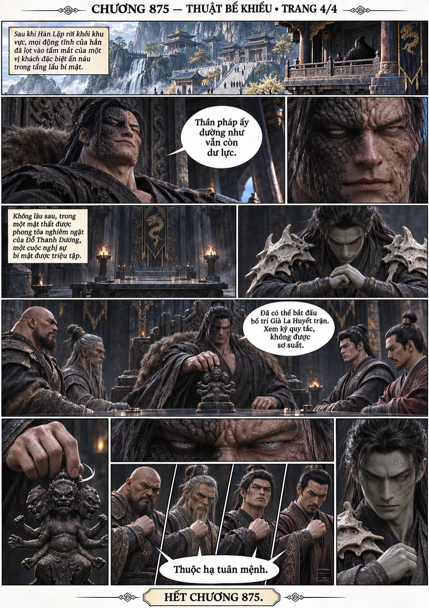

# Chương 875: Thuật Bế Khiếu

4 trang PNG riêng, tỉ lệ A4 dọc; chuyển thể từ văn bản người dùng đính kèm, có thoại, suy nghĩ và lời dẫn. Dùng model tham chiếu trong bộ nhớ dự án.

[PDF A4](chuong-875.pdf) · [Văn bản nguồn](SOURCE.txt)

Sau sáu năm, Hàn Lập đã mở 49 huyền khiếu và dùng thuật bế khiếu để giữ kín thực lực.

