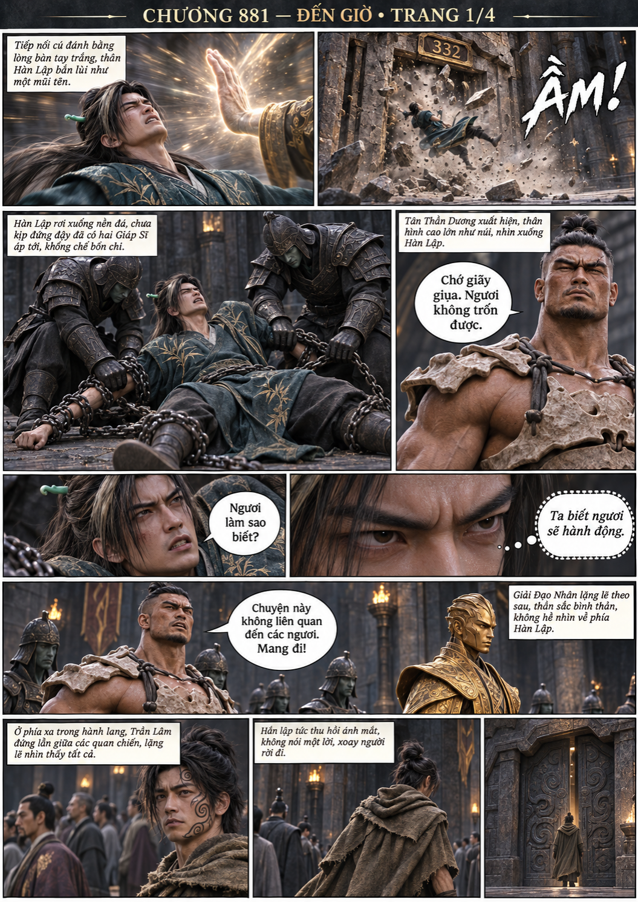
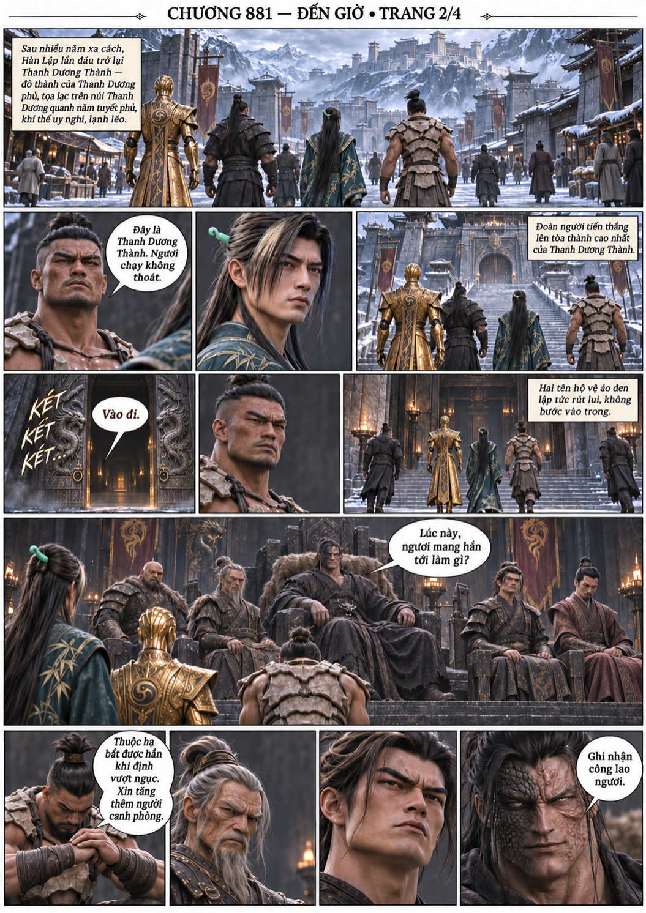
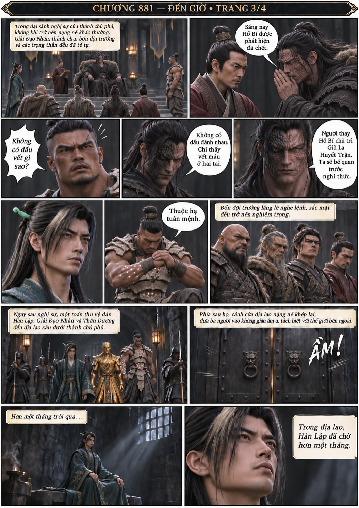
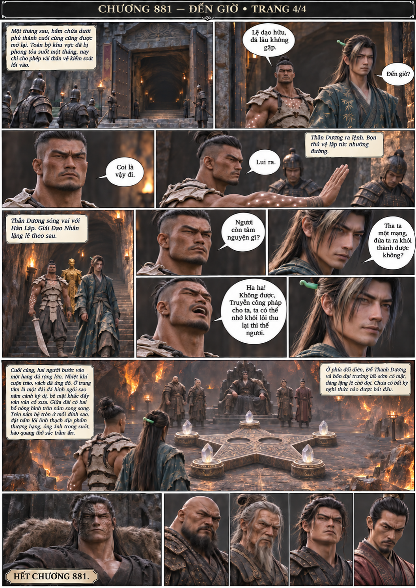

# Chương 881: Đến Giờ

4 trang PNG riêng, tỉ lệ A4 dọc; chuyển thể từ văn bản người dùng đính kèm, có thoại, suy nghĩ và lời dẫn. Dùng model tham chiếu trong bộ nhớ dự án.

[PDF A4](chuong-881.pdf) · [Văn bản nguồn](SOURCE.txt)

Thần Dương bắt Hàn Lập, thay Hổ Bí phụ trách Già La Huyết Trận rồi dẫn hắn tới thạch đài sau hơn một tháng.

