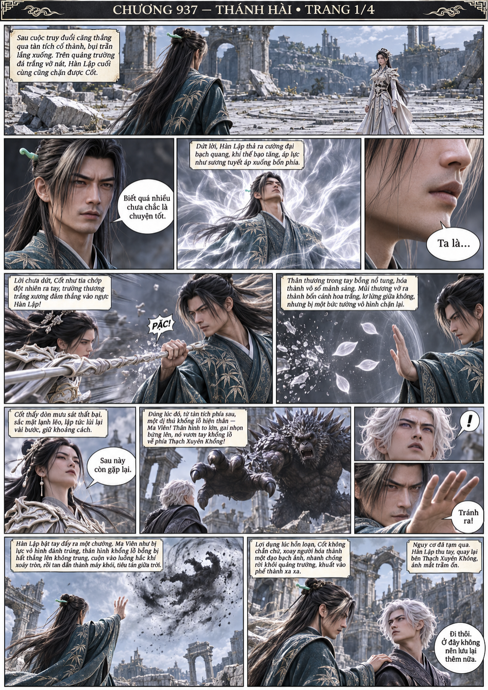
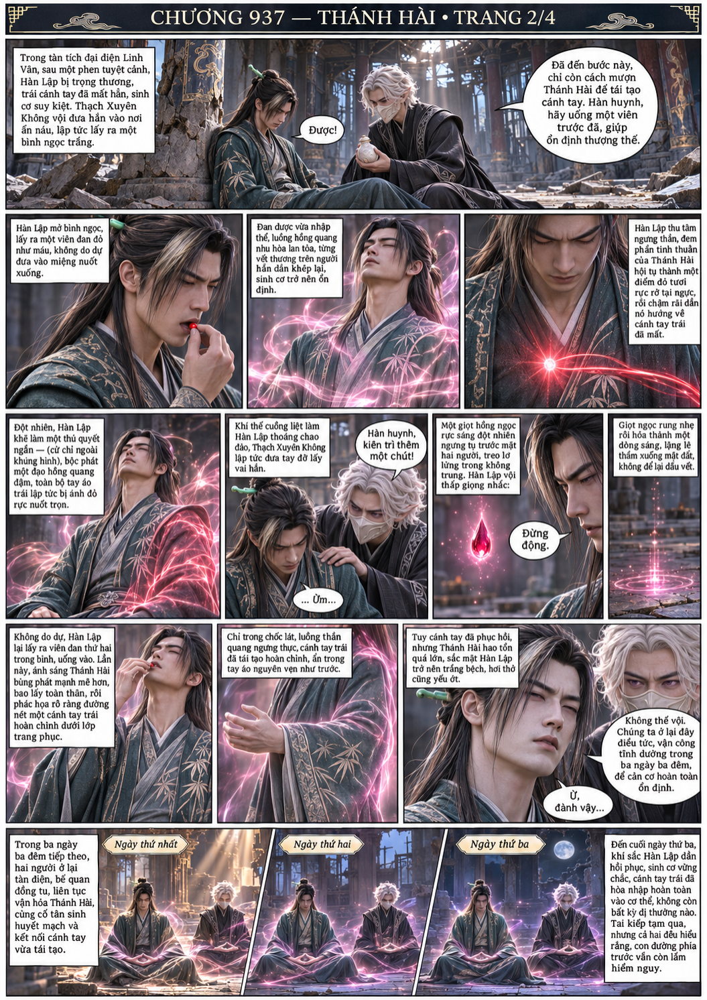
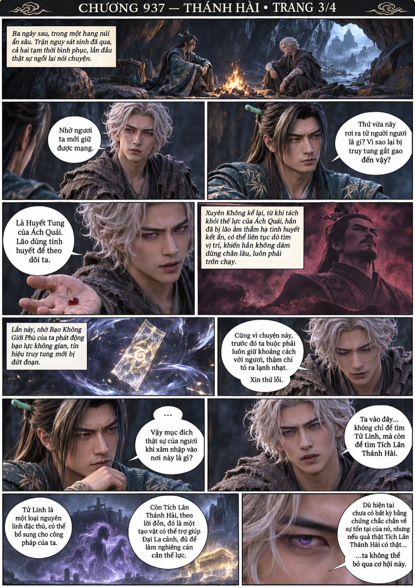
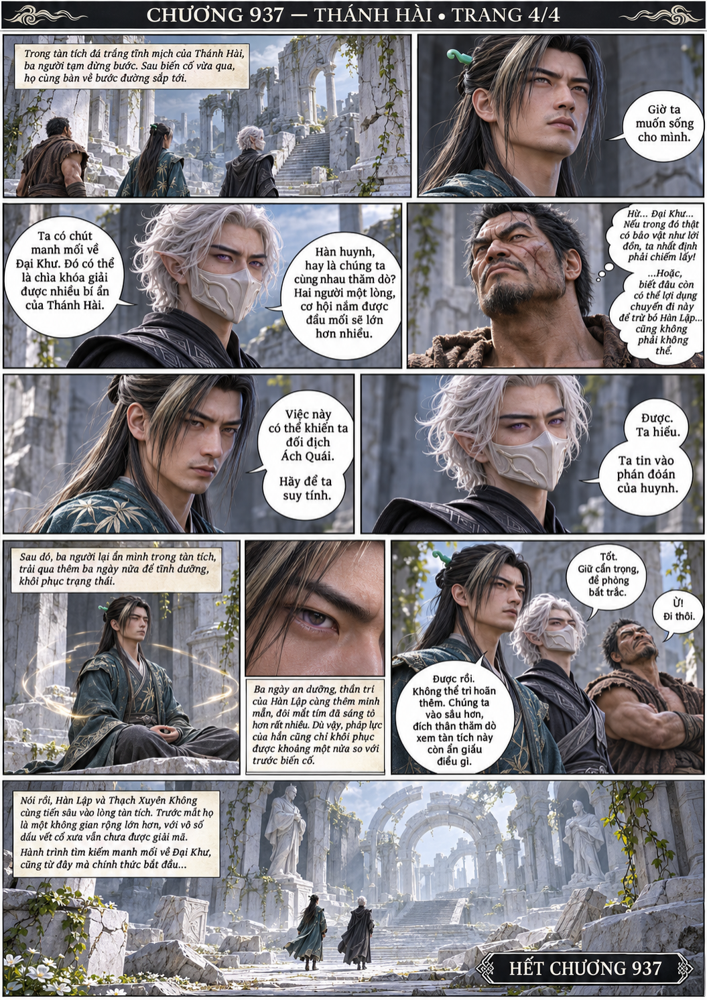

# Chương 937: Thánh Hài

4 trang PNG riêng, tỉ lệ A4 dọc; chuyển thể từ văn bản người dùng đính kèm, có thoại, suy nghĩ và lời dẫn. Dùng model tham chiếu trong bộ nhớ dự án.

[PDF A4](chuong-937.pdf) · [Văn bản nguồn](SOURCE.txt)

Cuộc đụng độ quanh Thánh Hài tiếp diễn. Hàn Lập và Thạch Xuyên Không phải cân nhắc bước tiếp theo giữa những toan tính còn bỏ ngỏ.

