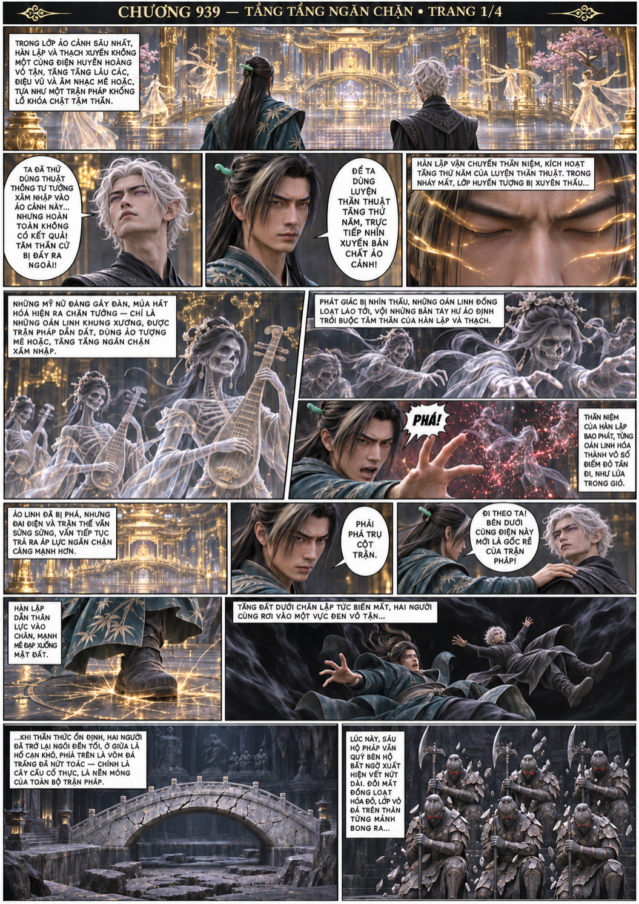
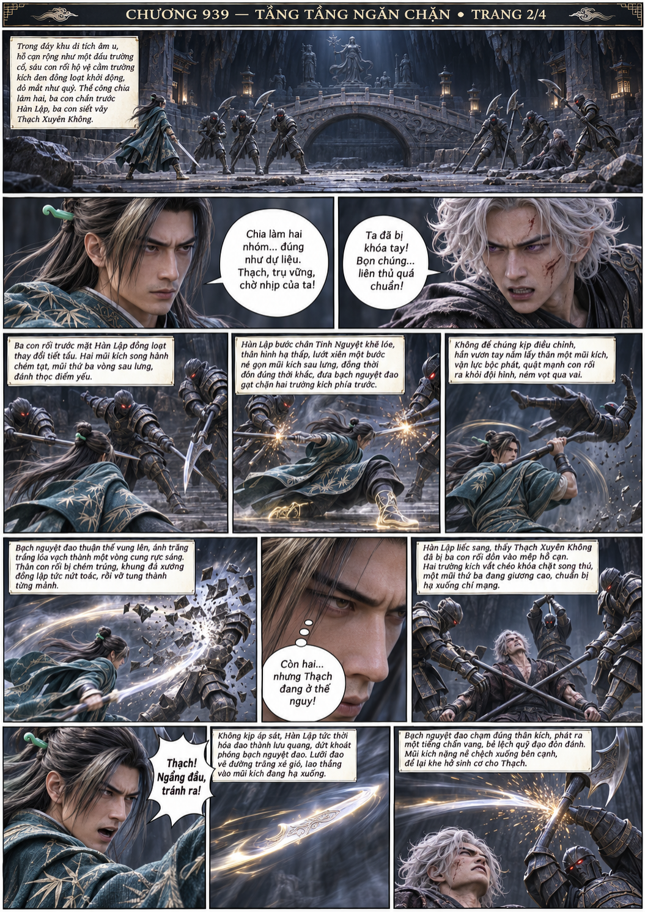
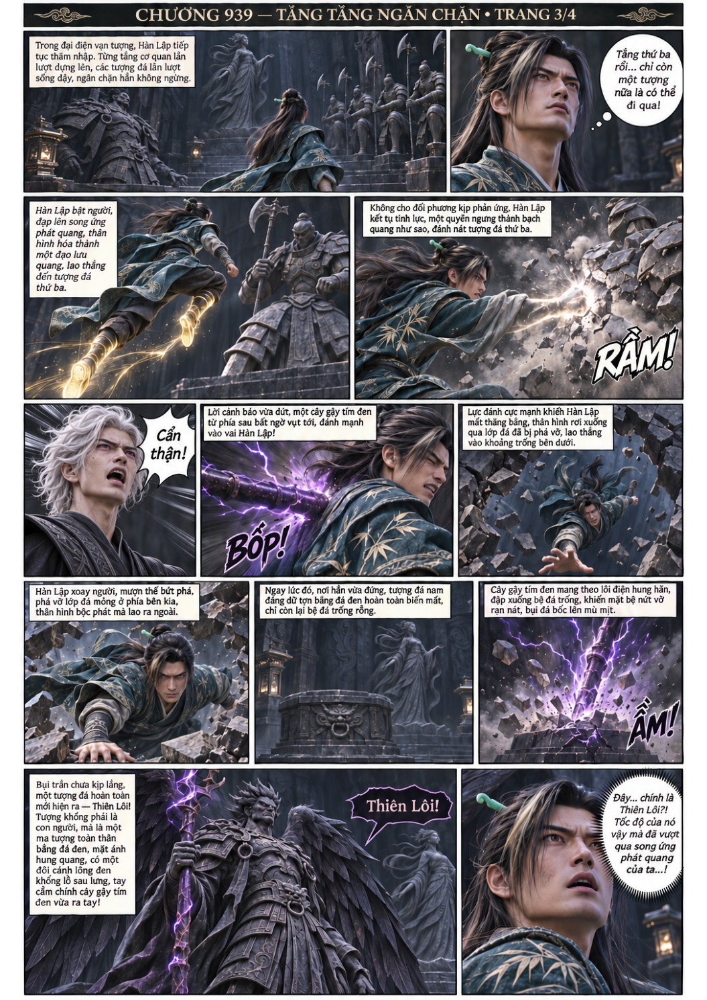
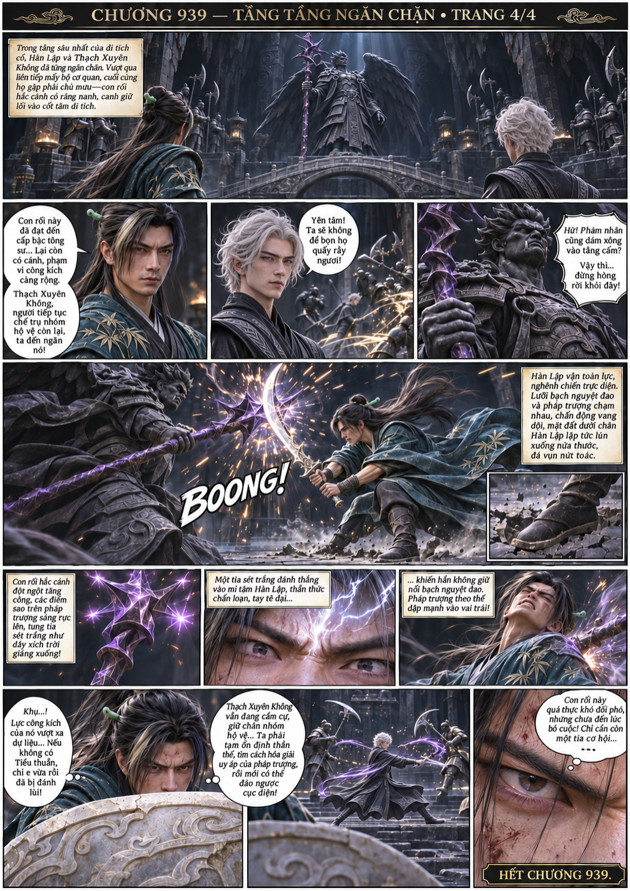

# Chương 939: Tầng Tầng Ngăn Chặn

4 trang PNG riêng, tỉ lệ A4 dọc; chuyển thể từ văn bản người dùng đính kèm, có thoại, suy nghĩ và lời dẫn. Dùng model tham chiếu trong bộ nhớ dự án.

[PDF A4](chuong-939.pdf) · [Văn bản nguồn](SOURCE.txt)

Các tượng đá lần lượt thức dậy. Hàn Lập và Thạch Xuyên Không đối mặt với khôi lỗi quỷ có cánh và cây trượng tím đen.

