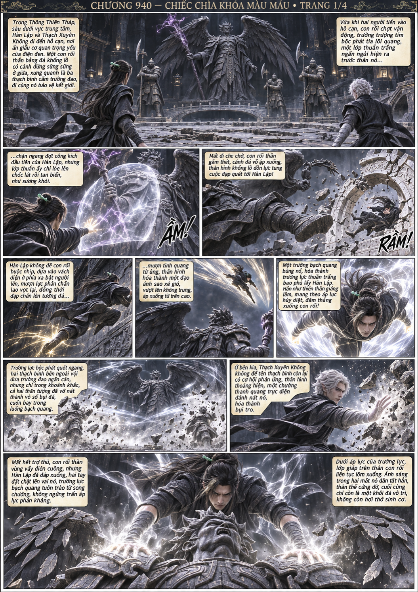
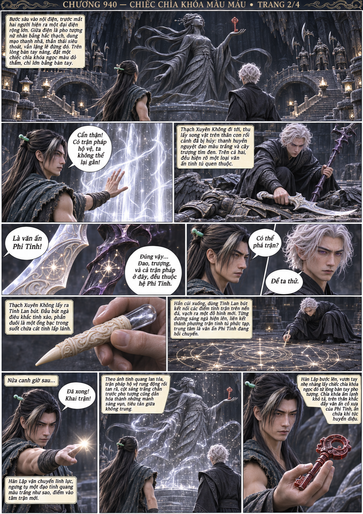
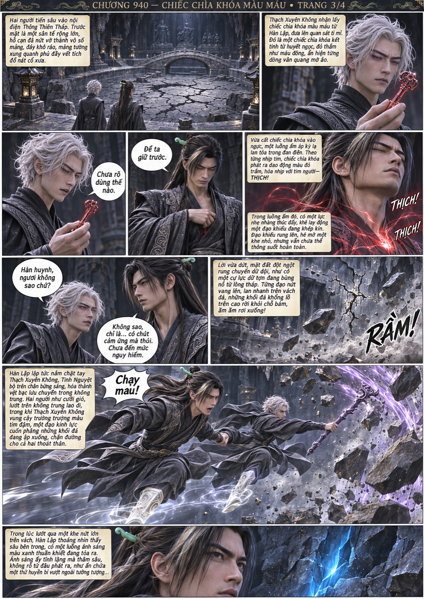
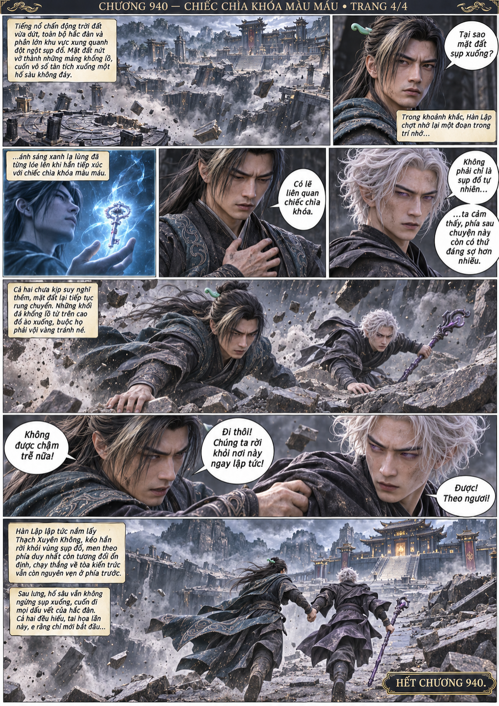

# Chương 940: Chiếc Chìa Khóa Màu Máu

4 trang PNG riêng, tỉ lệ A4 dọc; chuyển thể từ văn bản người dùng đính kèm, có thoại, suy nghĩ và lời dẫn. Dùng model tham chiếu trong bộ nhớ dự án.

[PDF A4](chuong-940.pdf) · [Văn bản nguồn](SOURCE.txt)

Cây trượng, cột đá và chìa khóa đỏ dẫn tới biến động lớn trong đại điện. Hai người tìm cách thoát khỏi nơi đang sụp đổ.

