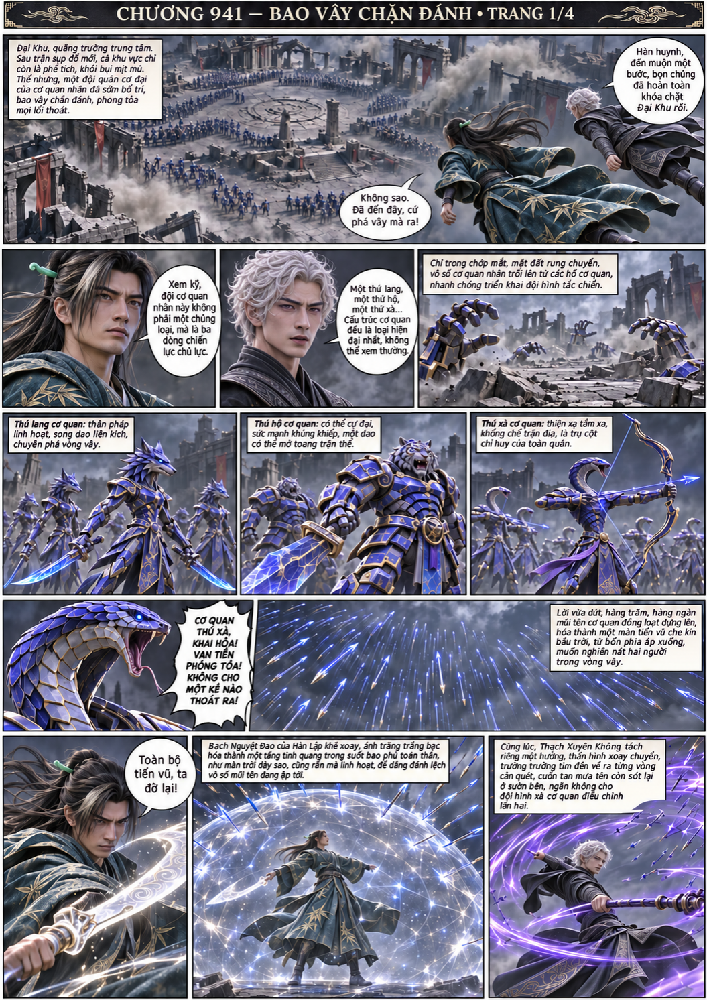
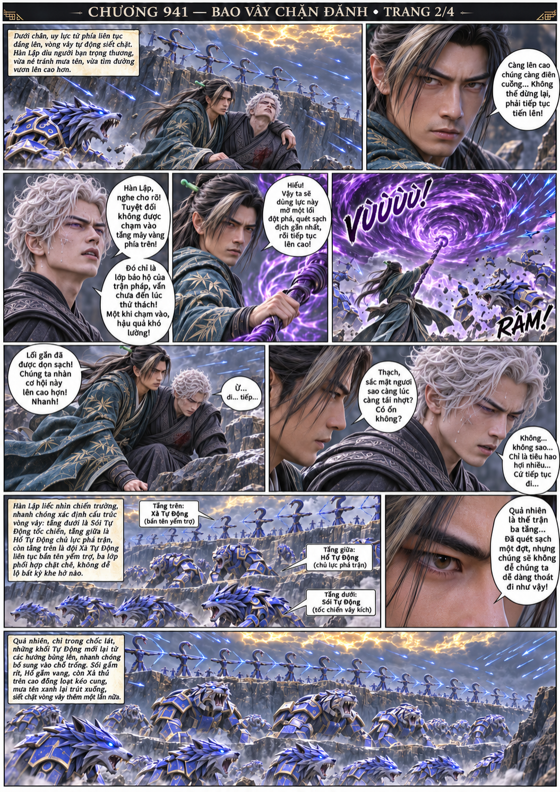
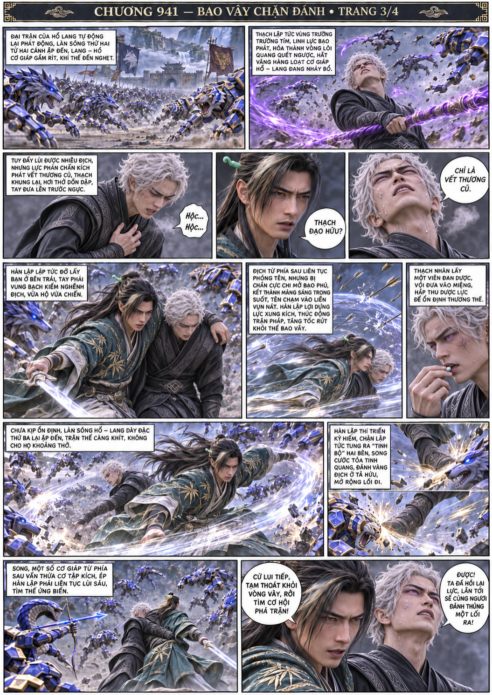
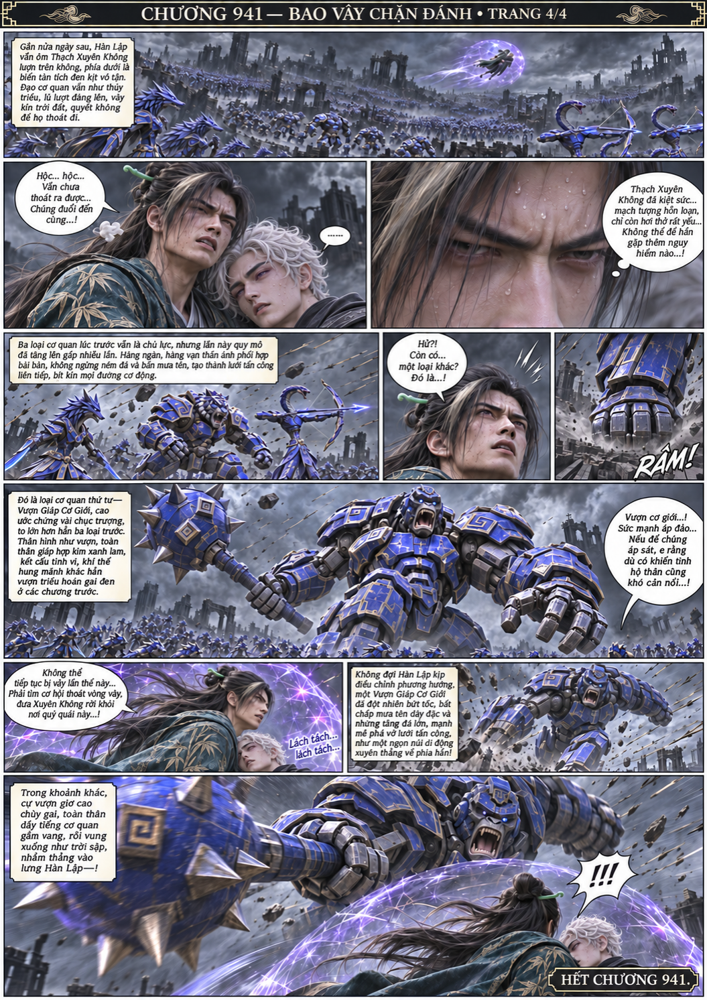

# Chương 941: Bao Vây Chặn Đánh

4 trang PNG riêng, tỉ lệ A4 dọc; chuyển thể từ văn bản người dùng đính kèm, có thoại, suy nghĩ và lời dẫn. Dùng model tham chiếu trong bộ nhớ dự án.

[PDF A4](chuong-941.pdf) · [Văn bản nguồn](SOURCE.txt)

Hàn Lập và Thạch Xuyên Không bị các khôi lỗi mặt thú bao vây. Từng đòn phản công mở ra cơ hội phá vòng vây.

