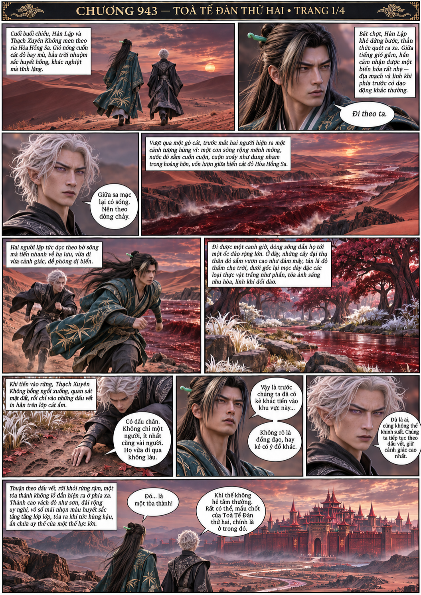
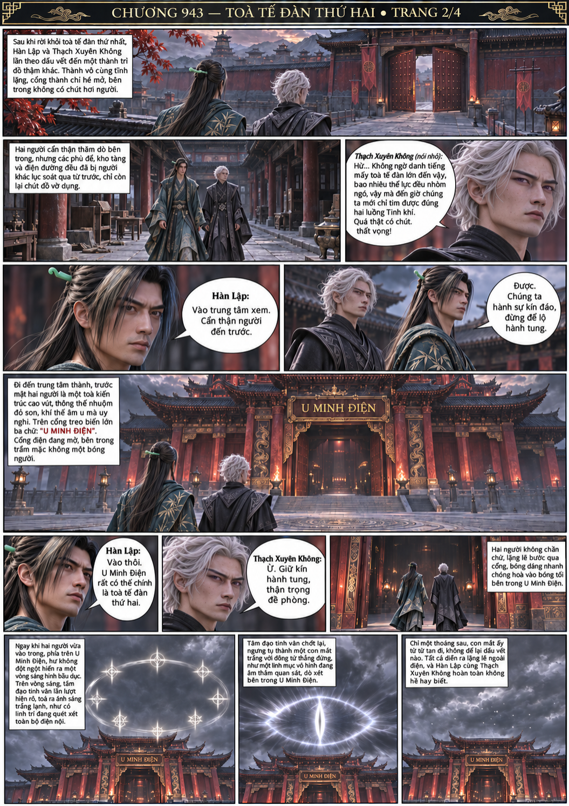
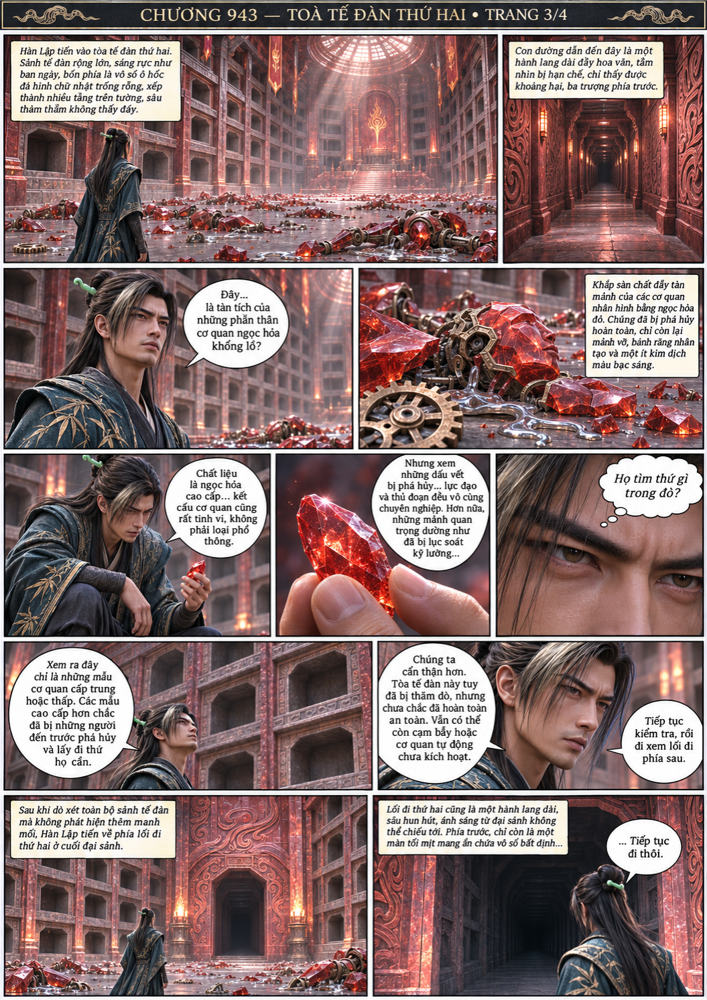
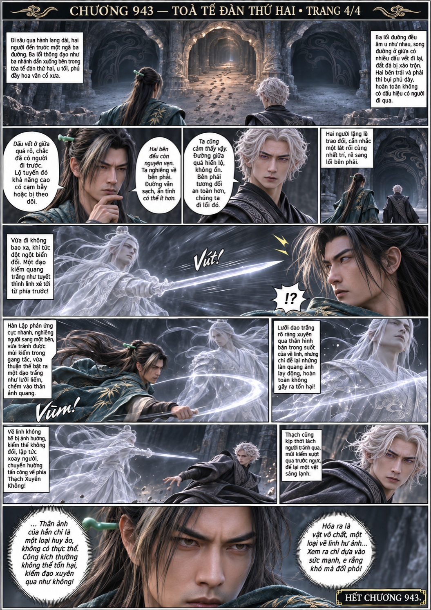

# Chương 943: Toà Tế Đàn Thứ Hai

4 trang PNG riêng, tỉ lệ A4 dọc; chuyển thể từ văn bản người dùng đính kèm, có thoại, suy nghĩ và lời dẫn. Dùng model tham chiếu trong bộ nhớ dự án.

[PDF A4](chuong-943.pdf) · [Văn bản nguồn](SOURCE.txt)

Hàn Lập và Thạch Xuyên Không vượt qua dòng sông đỏ sẫm rồi tìm đến tế đàn thứ hai tại U Minh Điện.

