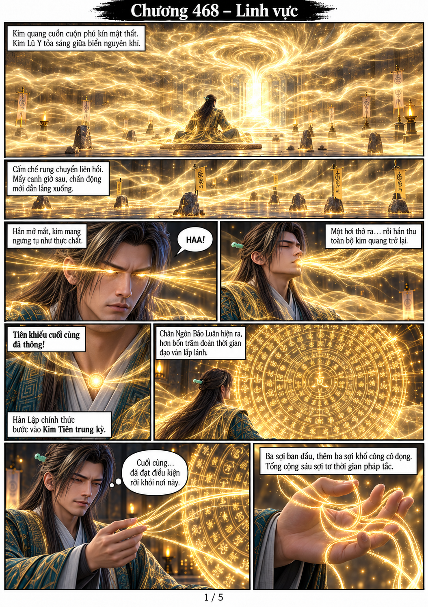
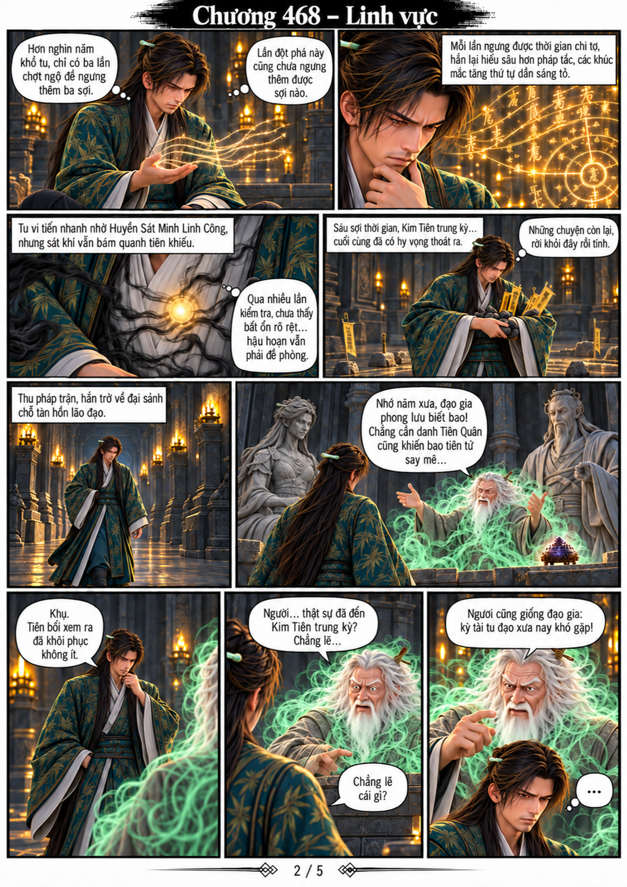
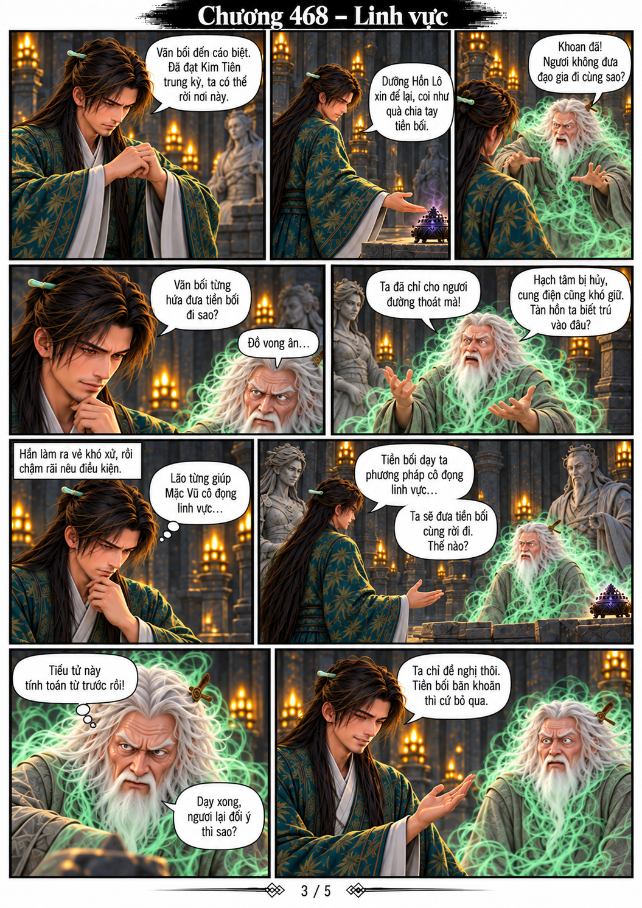
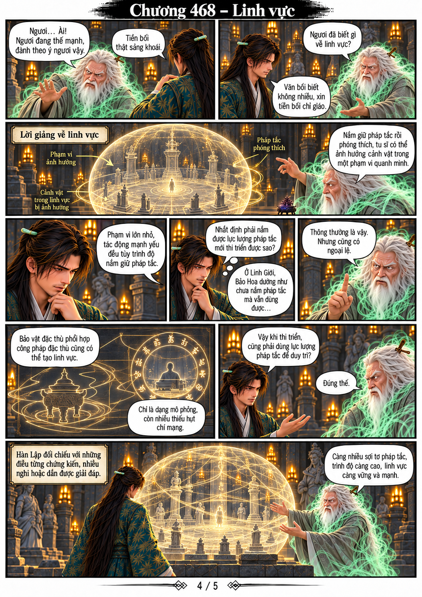
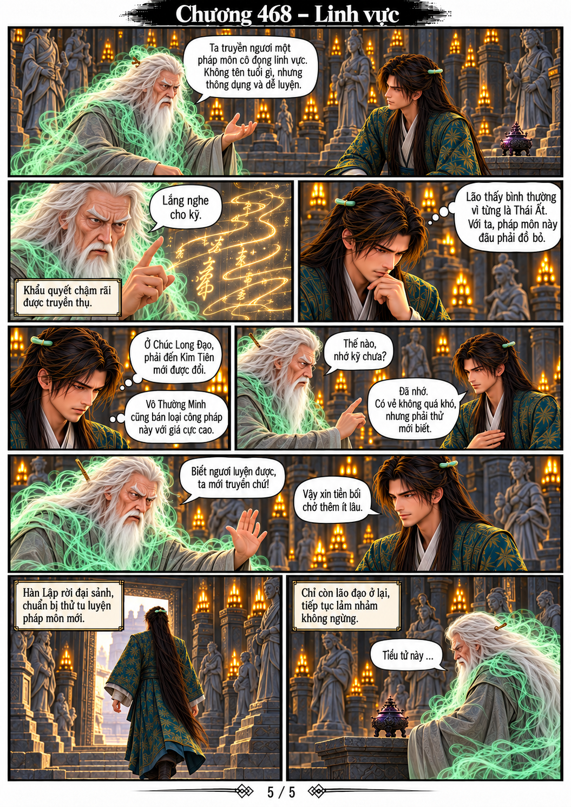

# Chương 468 — Linh vực — BẢN NHÁP

5 trang A4 dọc từ toàn bộ văn bản người dùng cung cấp. Có thoại, suy nghĩ và lời dẫn.

**Trạng thái: cần kiểm tra model.** Đã dùng trang truyện cũ làm tham chiếu thay cho gắn trực tiếp PNG model gốc; chưa đạt quy tắc PROJECT_MEMORY.md. Không dùng bộ này làm ảnh model chuẩn. Cần đối chiếu lại khuôn mặt Hàn Lập v2 và Vô Sinh VS-01 trước khi coi là bản chính thức.

Trang 2 dùng bản sửa cuối: trâm ngọc xanh dạng thanh, hoa văn trúc, lư hương chỉ ở đại điện và nữ tượng bằng đá.

## Trang 1

## Trang 2

## Trang 3

## Trang 4

## Trang 5

