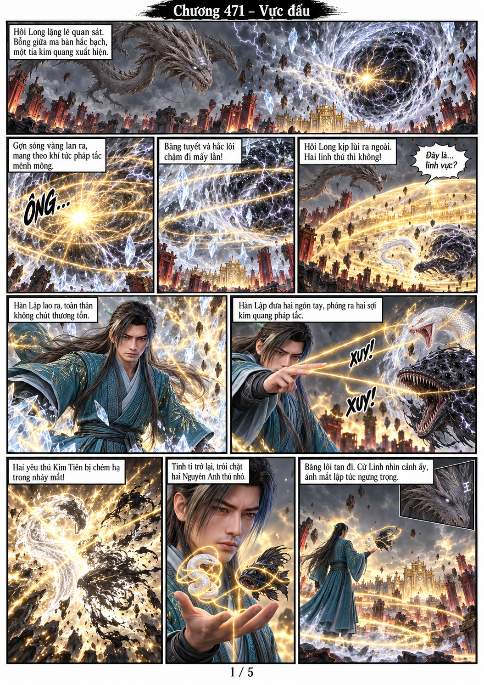
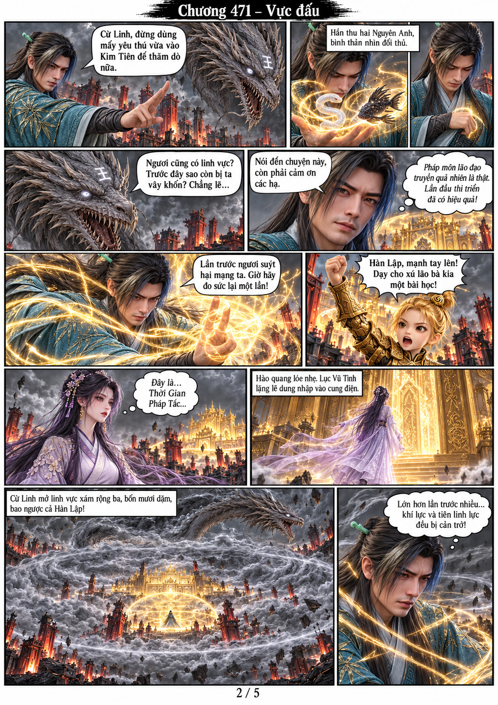
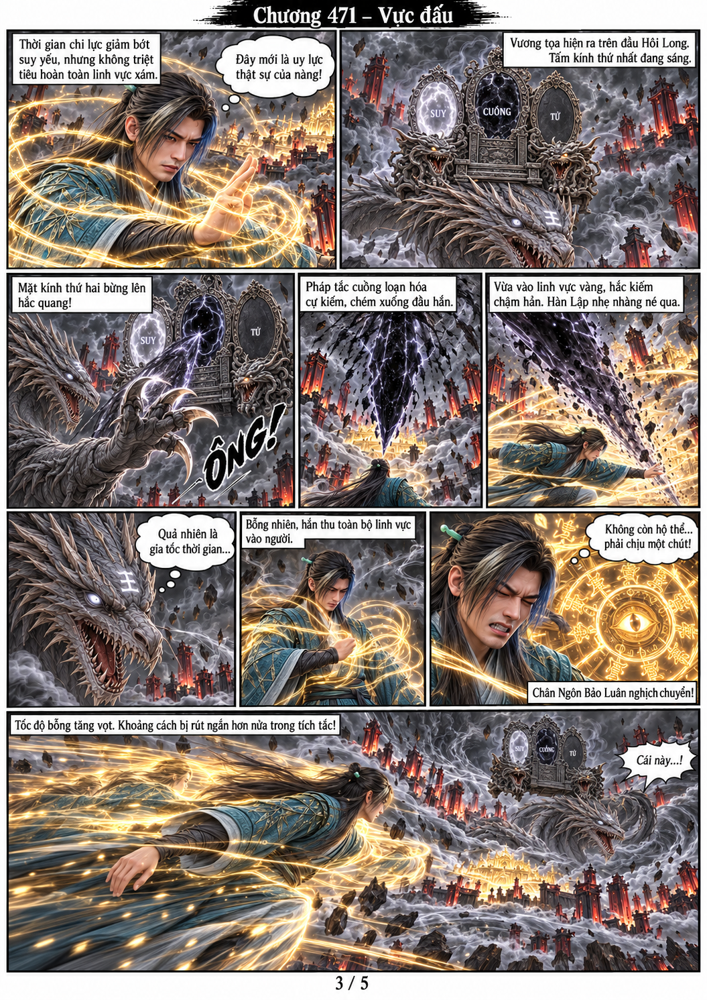

# Chương 471 — Vực đấu — ĐANG DỞ 3/5 trang

Đã tạo 3 trang ảnh A4 dọc bằng model gốc, còn trang4–5 mới có kịch bản. Công cụ tạo ảnh dừng do hạn mức429; chưa được coi đây là chương hoàn chỉnh.

## Trang 1

## Trang 2

## Trang 3

[Kịch bản chi tiết trang4–5 chưa tạo ảnh](STORYBOARD_TRANG_04_05.md).

[Nhân vật và diễn biến](../../CHARACTER_MEMORY.md), [quy tắc](../../PROJECT_MEMORY.md), [model](../../models/).
