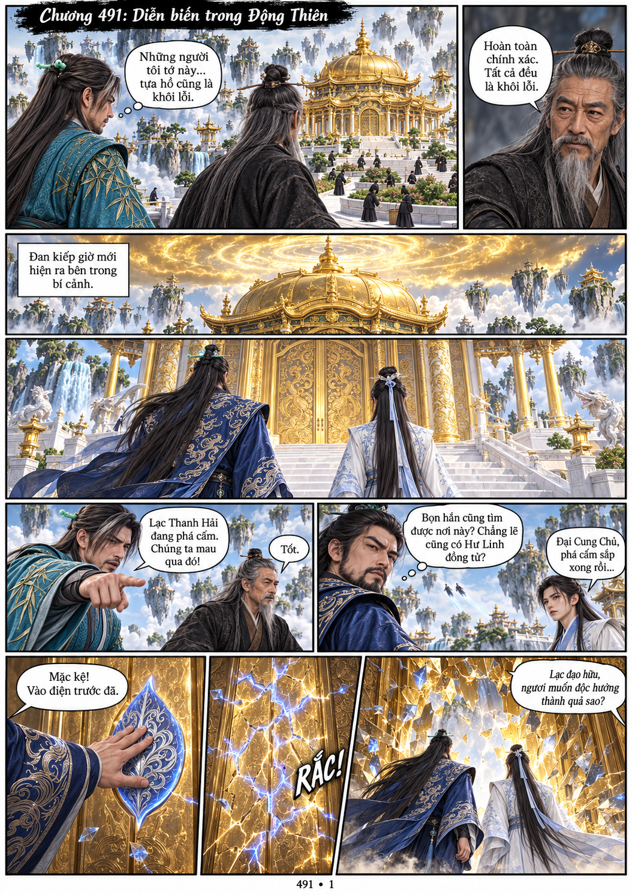
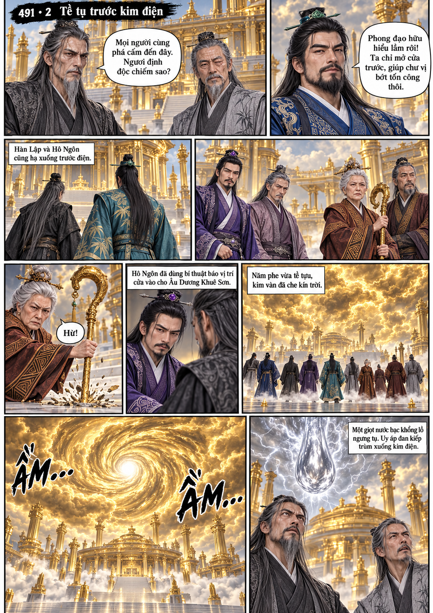
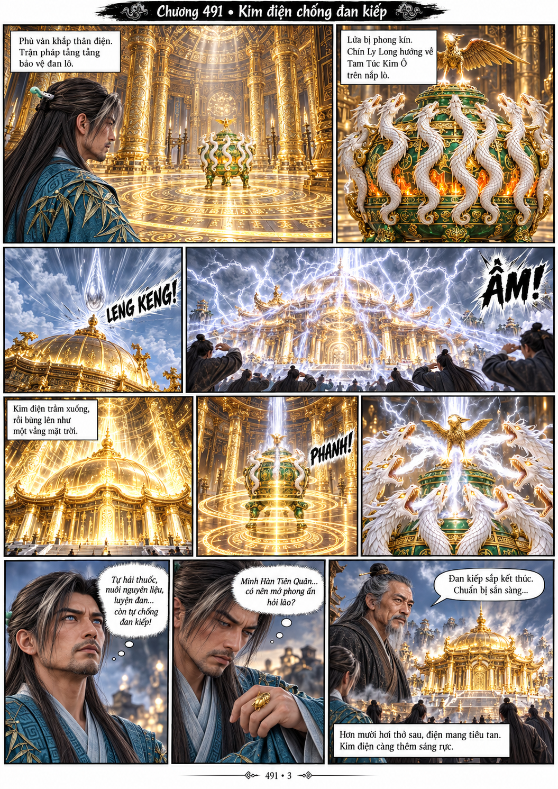
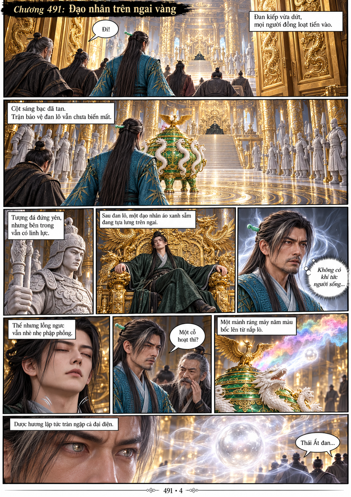

# Chương 491: Diễn biến trong Động Thiên — BẢN NHÁP CHƯA HOÀN THÀNH

Hiện có 4/5 trang, chưa phải bản đọc chính. Công cụ tạo ảnh đã chạm giới hạn khi tạo trang 5. Không bỏ phần kết chương để coi 4 trang này là hoàn chỉnh.

- Trang 1: Hàn Lập/Hô Ngôn xác nhận nô bộc là khôi lỗi, thấy đan kiếp; Lạc và Nam Kha phá cửa, bị gọi lại.
- Trang 2: Các phe tề tựu, kim vân và giọt nước bạc ngưng tụ. CẦN SỬA Tề Thiên Tiêu: mắt TRÁI của nhân vật (bên PHẢI người xem) phải khép có sẹo, mắt PHẢI mở; râu ngắn thưa theo model. Không được nhầm với Phong Thiên Đô râu dài, hai mắt lành. Trang hiện tại chưa đạt điểm này.
- Trang 3: Lò xanh/chín Ly Long/Tam Túc Kim Ô; kim điện chống đan kiếp; Hàn Lập nghĩ đến tàn hồn vẫn bị phong ấn, chưa mở lư.
- Trang 4: Vào điện, tượng khôi lỗi đá và hoạt thi trên ngai; xuất hiện viên Thái Ất đan đầu tiên.
- Trang 5: CHƯA TẠO. Xem PAGE-05-PROMPT.md; phải kết đúng không khí giương cung bạt kiếm, chưa đánh nhau.

Model mới đã lưu trước khi vẽ: ../../models/kim-dien-dan-lo-491.png và ../../models/hoat-thi-thach-khoi-loi-491.png. HT491 chưa rõ danh tính, không tự gán Vô Sinh/Hàn Lập/Công Thâu Cửu. Các model nhân vật cũ giữ nguyên; Hàn Lập đang dùng cải trang CT486.

