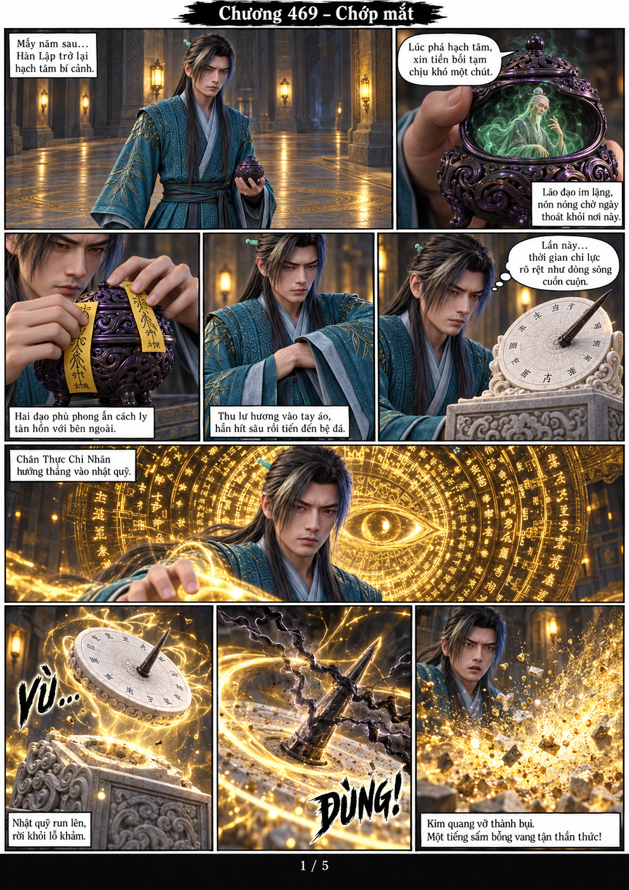
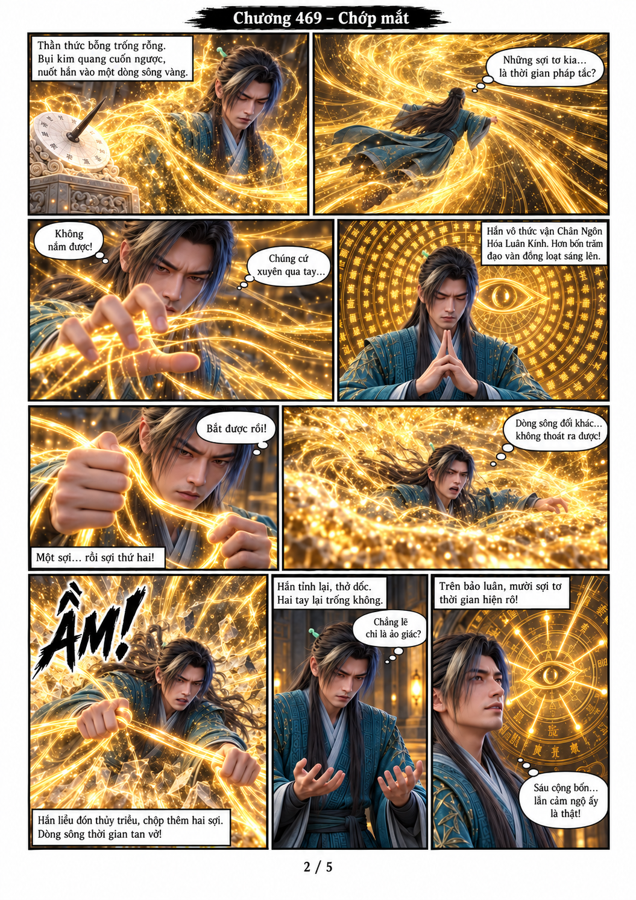
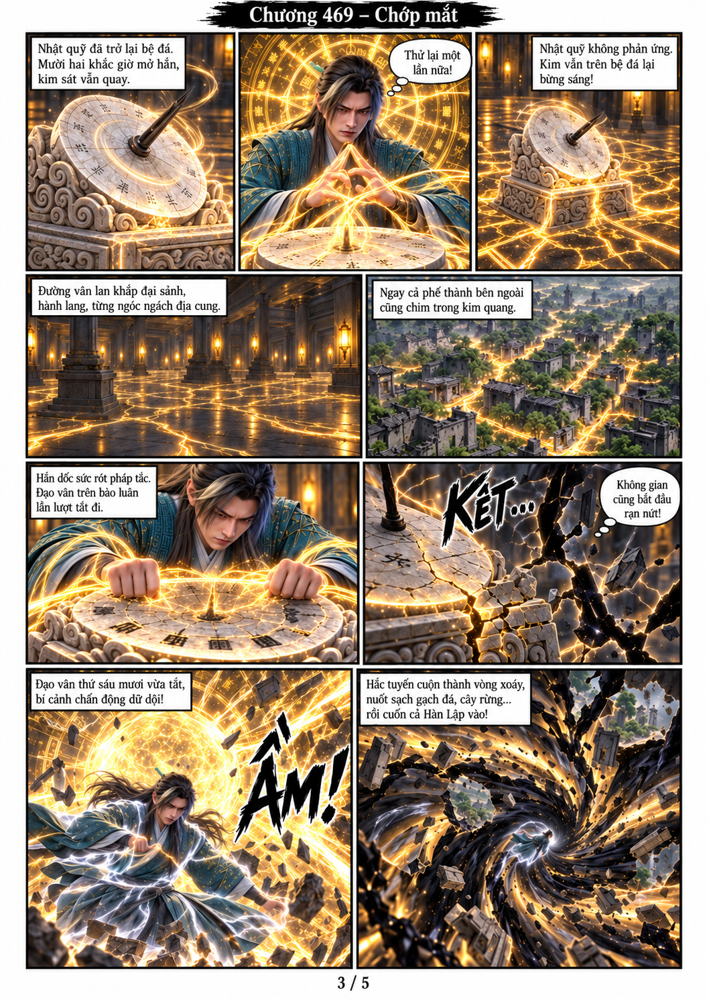
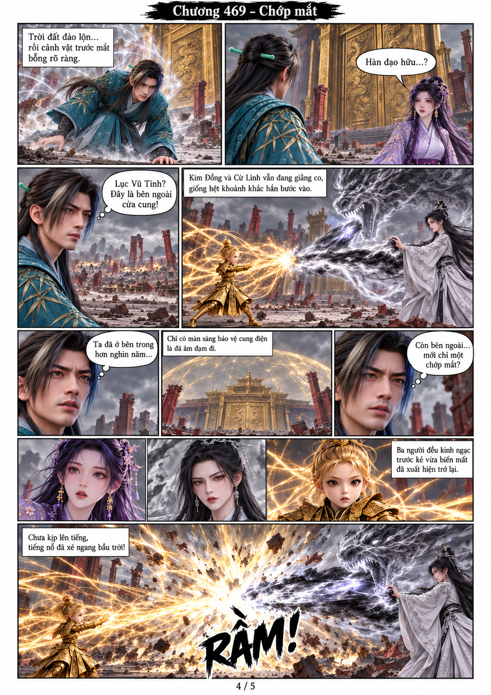
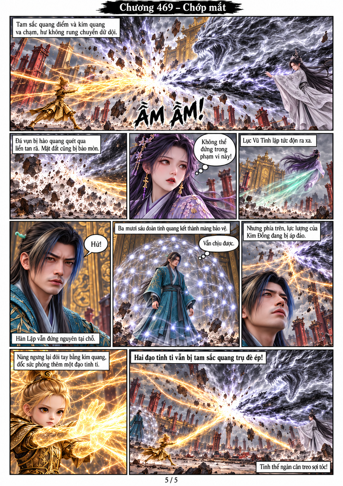

# Chương 469 — Chớp mắt

5 trang A4 dọc, chuyển thể từ toàn bộ văn bản người dùng dán trực tiếp. Dùng trực tiếp các ảnh PNG model gốc ở mỗi lần tạo: Hàn Lập v2, Lục Vũ Tình v2, Kim Đồng KD-ND-01, Cừ Linh CL-01, tàn hồn VS-01 và đạo cụ DHL-01/TANQ-01. Các model nhóm chọn đúng cột/góc; không có nhân vật mới.

## Trang 1

## Trang 2

## Trang 3

## Trang 4

## Trang 5

## Bộ nhớ

[Quy tắc dự án](PROJECT_MEMORY.md), [nhân vật và điểm nối chương](CHARACTER_MEMORY.md), [model gốc](../../models/). Kết thúc đúng tình thế nguy cấp của Kim Đồng; chưa sang hành động cứu viện ở chương470.
