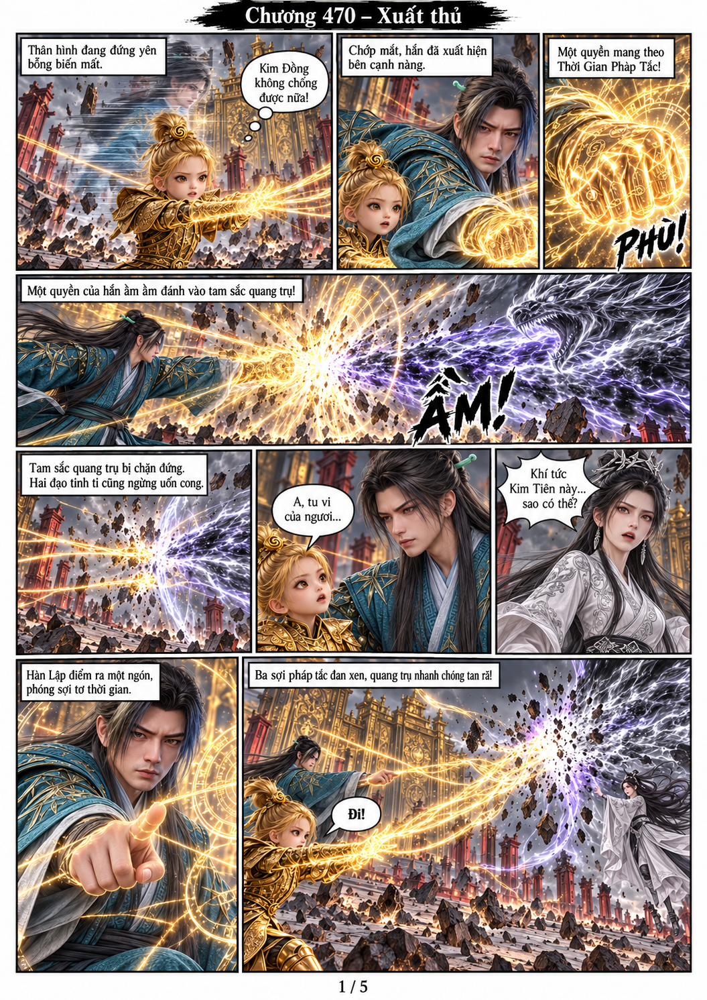
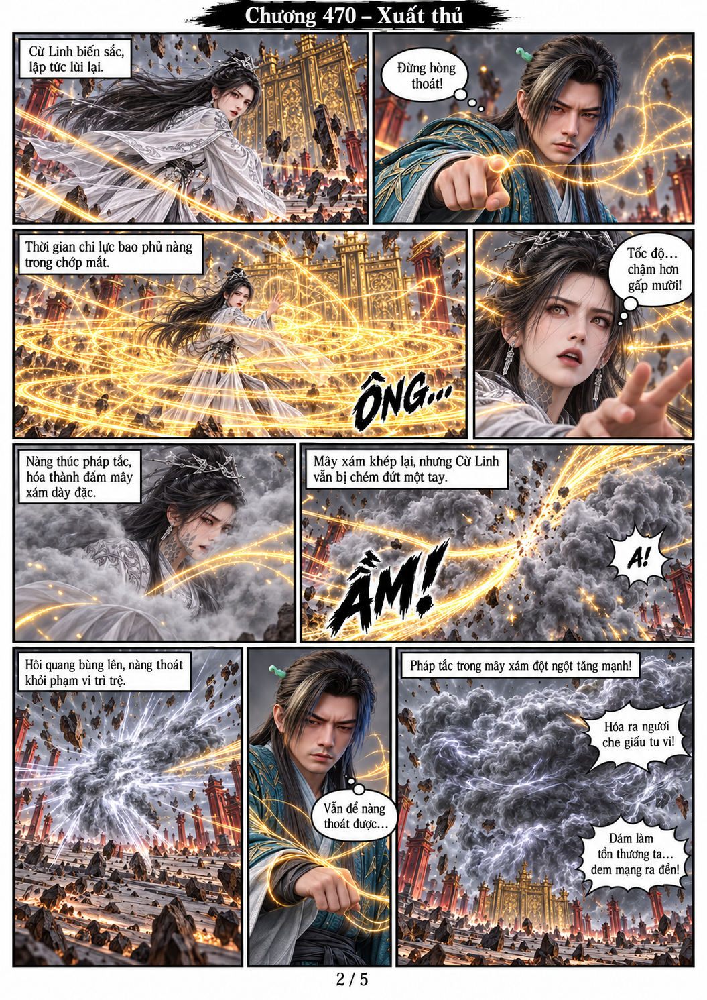
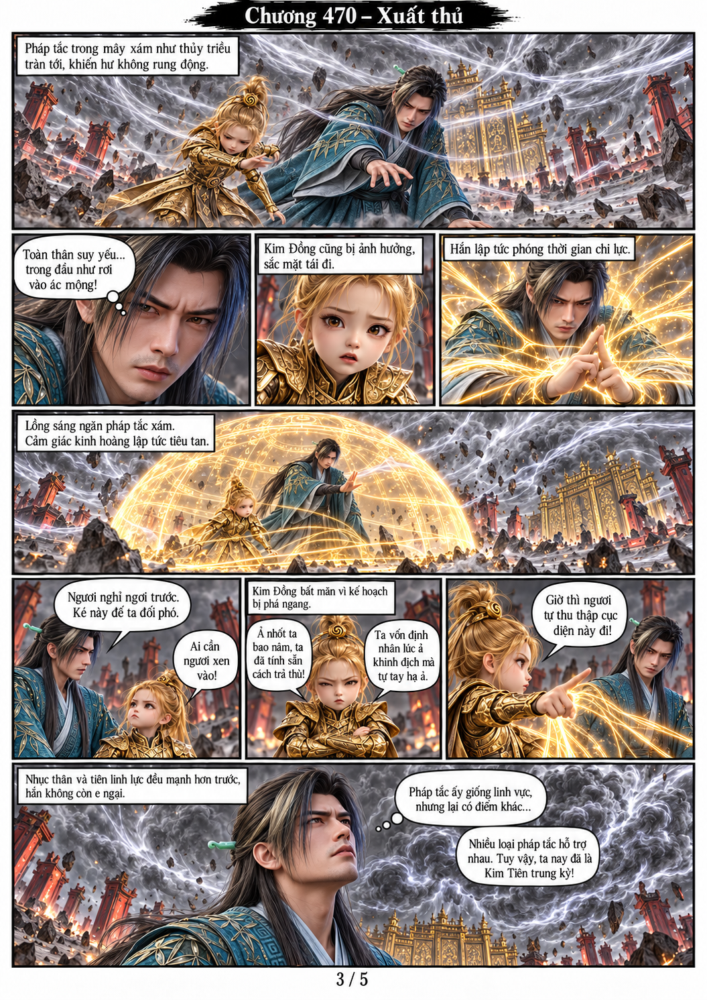
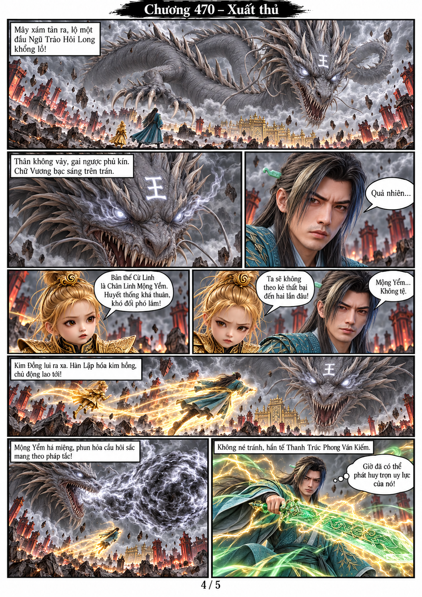
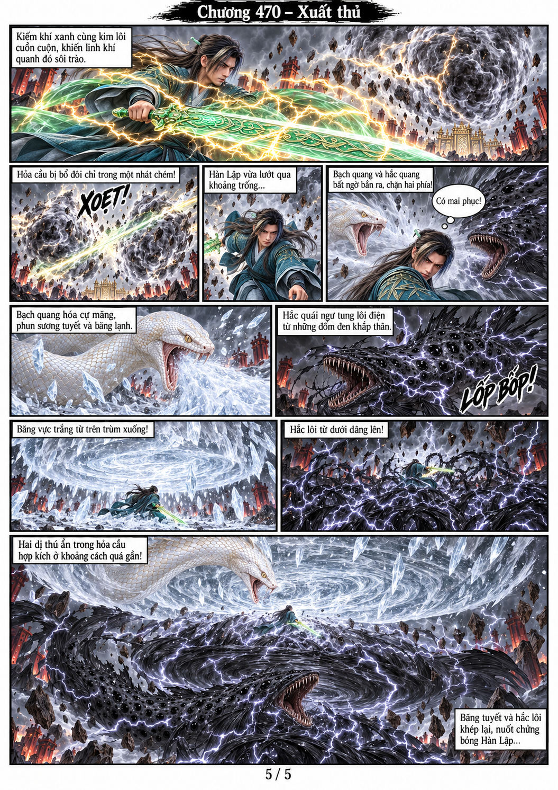

# Chương 470 — Xuất thủ

5 trang A4 dọc 1055×1491, chuyển thể từ toàn bộ văn bản người dùng cung cấp. Dùng trực tiếp model gốc của Hàn Lập v2, Kim Đồng KD-ND-01, Cừ Linh CL-01 và bạch mãng TB-01. Đã tạo/lưu ảnh tham chiếu Mộng Yểm CL-MY-01 và hắc quái ngư HQN-01 trước khi chúng xuất hiện trong tranh.

## Trang 1

## Trang 2

## Trang 3

## Trang 4

## Trang 5

## Bộ nhớ

[Quy tắc dự án](PROJECT_MEMORY.md), [nhân vật và điểm nối](CHARACTER_MEMORY.md), [model ảnh](../../models/). Kết chương khi Hàn Lập bị băng vực trắng và hắc lôi ép hai phía; chưa kể diễn biến chương471.
