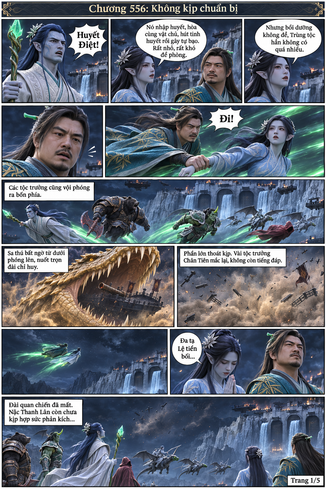

# Chương 556 — ảnh nháp trang 1, chưa hoàn thành

Đây là ảnh tạo dở trước khi công cụ hết hạn mức; KHÔNG tính là chương hoàn chỉnh và chưa xuất bản trong chapters/556.

Cần sửa bằng imagegen trước khi duyệt:

- Sa thú phải nuốt **đài chỉ huy phẳng màu đen không nòng pháo**, theo ô dưới-trái model552; ảnh nháp đang nhầm với chiến xa Hỏa Thần có nòng.
- Ở khung cuối chỉ giữ Nặc Thanh Lân và nhóm thủ lĩnh tại chỗ cũ; bỏ Hàn Lập/Nặc Y Phàm khỏi nhóm. Hai người đã bay ra xa hơn mười dặm ở các khung trước.
- Sau đó kiểm tra lại thoại, gương mặt NYF, diện mạo CT543 và dàn trang A4. Không tự sửa thành ảnh hoàn chỉnh bằng phép ghép thay thế công cụ tạo ảnh.

Model cho556 và biến thể557 đã lưu trong models/. Kịch bản trang2–5 và các chương557–559 ở thư mục cha.

